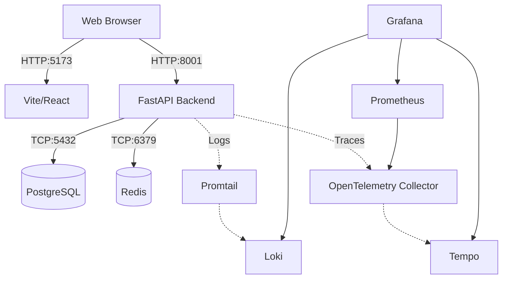

# ConfessIt - Project Knowledge Base

## Table of Contents
1. [Executive Summary](#1-executive-summary)
2. [Repository Structure](#2-repository-structure)
3. [Technology Stack Analysis](#3-technology-stack-analysis)
4. [Dependency Analysis](#4-dependency-analysis)
5. [Architecture Deep Dive](#5-architecture-deep-dive)
6. [Runtime Flow Analysis](#6-runtime-flow-analysis)
7. [Request Lifecycle Analysis](#7-request-lifecycle-analysis)
8. [Feature Inventory](#8-feature-inventory)
9. [Module Documentation](#9-module-documentation)
10. [Code Flow Mapping](#10-code-flow-mapping)
11. [Database Analysis](#11-database-analysis)
12. [API Documentation](#12-api-documentation)
13. [Authentication & Authorization](#13-authentication--authorization)
14. [State Management Analysis](#14-state-management-analysis)
15. [Configuration Management](#15-configuration-management)
16. [Build & Deployment](#16-build--deployment)
17. [Infrastructure Analysis](#17-infrastructure-analysis)
18. [Testing Strategy](#18-testing-strategy)
19. [Logging, Monitoring & Observability](#19-logging-monitoring--observability)
20. [Security Review](#20-security-review)
21. [Performance Analysis](#21-performance-analysis)
22. [Technical Debt Assessment](#22-technical-debt-assessment)
23. [Maintenance Guide](#23-maintenance-guide)
24. [Onboarding Guide](#24-onboarding-guide)
25. [Diagrams](#25-diagrams)
26. [Assumptions and Inferred Behavior](#26-assumptions-and-inferred-behavior)

---

## 1. Executive Summary

**Project Overview:**
ConfessIt is a full-stack web application serving as a safe, anonymous space for users (likely students within an institution, given fields like `regno` and `class_name`) to share thoughts, confess feelings, and connect. 

**Business Purpose:**
To foster community engagement through anonymity and gamified social interaction, providing tools like anonymous confessions, matchmaking, and "love notes".

**Core Functionality:**
- **Anonymous Confessions:** Users can post and react/comment to anonymous messages.
- **Matchmaking:** An algorithmic or randomized pairing system to connect users.
- **Love Notes:** Anonymous or signed digital notes containing text and images.
- **Real-time/Async Messaging:** Conversations between matched users.
- **Moderation:** Admin dashboards for reviewing reported confessions, love notes, and users.

**Target Users:**
Students/Peers in an academic or enclosed organizational environment.

**Architectural Style:**
Containerized Monolithic Backend (FastAPI) paired with an SPA Frontend (React), heavily augmented by a robust observability stack (OpenTelemetry, Grafana, Loki, Prometheus).

---

## 2. Repository Structure

```text
/ConfessIt_V2
├── backend/              # Python FastAPI backend application
│   ├── app/              # Main application code
│   │   ├── routers/      # API Route definitions (Controllers)
│   │   ├── services/     # Business logic layer
│   │   ├── config.py     # Configuration and environment variables
│   │   ├── dependencies.py # FastAPI dependencies (e.g., get_db)
│   │   ├── logger.py     # Custom logging configuration
│   │   ├── main.py       # FastAPI application entry point
│   │   ├── models.py     # Pydantic schema and PostgreSQL representations
│   │   └── utils.py      # Shared utility functions
│   ├── tests/            # Pytest test suites
│   ├── archives/         # Stored artifacts/archives (mounted volume)
│   ├── Dockerfile        # Backend containerization
│   └── requirements.txt  # Python dependencies
├── frontend/             # React/Vite SPA frontend application
│   ├── src/
│   │   ├── assets/       # Static assets (images, fonts)
│   │   ├── components/   # Reusable UI components (Shadcn UI)
│   │   ├── contexts/     # React Context providers (AuthContext)
│   │   ├── hooks/        # Custom React hooks
│   │   ├── lib/          # Utility libraries (clsx, tailwind-merge)
│   │   ├── pages/        # Route components (Pages)
│   │   ├── services/     # API clients (Axios wrappers)
│   │   ├── App.tsx       # Main routing setup
│   │   └── main.tsx      # React DOM rendering entry point
│   ├── public/           # Public static files
│   ├── Dockerfile        # Frontend containerization
│   ├── package.json      # Node.js dependencies
│   ├── tailwind.config.ts# Tailwind CSS configuration
│   └── vite.config.ts    # Vite build configuration
+-- postgres_data/        # Persistent PostgreSQL data volume
├── nginx/                # NGINX configuration (if used as reverse proxy in prod)
├── observability/        # Telemetry, logging, and metrics configuration
│   ├── loki-config.yml
│   ├── otel-collector-config.yml
│   ├── prometheus.yml
│   ├── promtail-config.yml
│   └── tempo.yml
├── .env                  # Root environment variables
├── docker-compose.yml    # Orchestration of all services
└── README.md             # Project documentation
```

---

## 3. Technology Stack Analysis

### Frontend
- **Framework:** React 18 (SPA) via Vite. *Why: Fast builds, modern ecosystem.*
- **State Management:** TanStack Query (React Query) and React Context. *Why: Efficient server state caching and global auth state.*
- **Styling:** Tailwind CSS + Shadcn UI + Radix UI primitives. *Why: Rapid, accessible, and consistent UI component development.*
- **Routing:** React Router DOM v6.
- **Form Handling & Validation:** React Hook Form + Zod. *Why: Type-safe, performant form validation.*

### Backend
- **Framework:** FastAPI (Python). *Why: High performance, async support, automatic OpenAPI docs.*
- **Data Validation:** Pydantic v2. *Why: Strict typing, serialization, validation.*
- **Server:** Uvicorn. *Why: ASGI server to run FastAPI asynchronously.*

### Database
- **Engine:** PostgreSQL. *Why: Flexible schema, suitable for unstructured confessions and nested comments.*
- **Driver:** SQLAlchemy ORM with psycopg. *Why: Native Python integration with PostgreSQL.*
- **Caching:** Redis. *Why: Fast access to session data, rate limiting, or transient matchmaking state.*

### Observability & DevOps
- **Containerization:** Docker & Docker Compose.
- **Tracing:** OpenTelemetry + Grafana Tempo.
- **Metrics:** Prometheus + Grafana.
- **Logging:** Grafana Loki + Promtail.

---

## 4. Dependency Analysis

**Internal Dependency Graph (Backend):**
`main.py` -> `routers/` -> `services/` -> `models.py` & `dependencies.py` (DB connection).

**External Dependency Graph:**
- **Frontend -> Backend:** The React SPA communicates with the FastAPI backend over REST (`http://localhost:8001`).
- **Backend -> PostgreSQL:** TCP connection on `5432` to store persistent application state.
- **Backend -> Redis:** TCP connection on `6379` for caching/sessions.
- **Backend -> OpenTelemetry Collector:** gRPC connection on `4317` to export spans and metrics.

**Coupling Areas:**
The frontend heavily relies on the structure defined in the backend's `models.py`. Any schema change requires a parallel TypeScript interface update (or implicit change if not strictly typed).

---

## 5. Architecture Deep Dive

**System Architecture:**
The system uses a **Containerized Microservices-adjacent Architecture** via Docker Compose. While the application code is divided into a monolithic backend and an SPA frontend, auxiliary concerns (database, caching, telemetry, logging, metrics) are completely decoupled into their own containers.

**Application Architecture (Backend):**
Follows a **Layered/Onion Architecture**:
1. **Presentation/Transport Layer (`routers/`):** Defines HTTP endpoints, accepts requests, performs initial Pydantic validation.
2. **Business Logic Layer (`services/`):** Contains core rules (e.g., `confession_service.py`).
3. **Data Access Layer:** SQLAlchemy ORM queries against typed PostgreSQL tables. 

**Data Architecture:**
Application records use typed relational PostgreSQL tables defined in `backend/app/db_models.py`. Relationships are represented with foreign keys; IDs use native UUIDs and timestamp values use `TIMESTAMPTZ`. PostgreSQL arrays store homogeneous lists, while JSONB is reserved for the variable confession reaction map.

---

## 6. Runtime Flow Analysis

**Feature: Submitting a Confession**
1. **Entry Point:** User clicks submit on the frontend UI.
2. **Frontend Validation:** React Hook Form + Zod validates the input.
3. **API Call:** Axios POST request is made to `/confessions` with Bearer token.
4. **Backend Router (`routers/confessions.py`):** Receives request, injects `get_current_user` dependency to ensure authentication.
5. **Validation:** Pydantic validates `ConfessionCreate` schema.
6. **Business Logic (`confession_service.py`):** Applies business rules (e.g., checks if user is banned, constructs DB payload).
7. **Data Access:** SQLAlchemy ORM with psycopg inserts the record into the `confessions` table.
8. **Response:** Created confession object is serialized and returned 200 OK.
9. **Frontend Update:** TanStack Query invalidates the confession list cache, triggering a re-render.

---

## 7. Request Lifecycle Analysis

**Trace:** `GET /auth/me`
1. **User:** Opens the app.
2. **Client:** `getCurrentUser` in `api.ts` checks `localStorage` for `accessToken`.
3. **Middleware (FastAPI):** Request hits FastAPI, passes through `CORSMiddleware`.
4. **Dependency Injection:** Router depends on `get_current_user` from `auth_service.py`.
5. **Auth Service:** Extracts JWT from the `Authorization` header.
6. **Decoding:** PyJWT decodes the token, validating expiration and signature.
7. **Database:** Extracts `user_id` from token payload, queries the `users` table through SQLAlchemy.
8. **Response Generation:** Serializes the user document into a JSON response and returns it to the client.
9. **Client Context:** AuthContext updates with user info, allowing route access.

---

## 8. Feature Inventory

| Feature | Purpose | Domain | Key Files |
|---------|---------|--------|-----------|
| **Magic Link Auth** | Passwordless authentication | Auth | `auth.py`, `auth_service.py`, `Login.tsx` |
| **Anonymous Confessions** | Post thoughts anonymously | Social | `confessions.py`, `ConfessionsPage.tsx` |
| **Matchmaking** | Pair users together | Connection | `matchmaking.py`, `MatchmakingPage.tsx` |
| **Love Notes** | Send digital cards to crushes | Social | `love_notes.py`, `LoveNotesPage.tsx` |
| **Chat/Conversations** | Direct messaging for matches | Messaging | `conversations.py`, `InboxPage.tsx` |
| **Admin Dashboard** | Moderate content and users | Admin | `admin.py`, `AdminDashboard.tsx` |

---

## 9. Module Documentation

### `app.main` (Backend Entrypoint)
- **Responsibility:** App initialization, route registration, middleware configuration, OpenTelemetry setup, and DB schema creation on startup.
- **Internal Logic:** The `@app.on_event("startup")` hook waits for PostgreSQL, connects, seeds default "Test User" and "Test Admin" if they do not exist, and creates optimized database indexes.

### `app.models` (Domain Entities)
- **Responsibility:** Single source of truth for data structures.
- **Key Models:** `Confession`, `ConfessionComment`, `UserDetails`, `LoginToken`, `LoveNote`, `Match`, `Conversation`, `Message`.
- **Logic:** Uses Pydantic models with canonical `id` fields and snake_case API fields.

### `src/contexts/AuthContext` (Frontend State)
- **Responsibility:** Manage global authentication state.
- **Logic:** Maintains `user`, `isAuthenticated`, and `isLoading` state. Refreshes context on mount via `getCurrentUser()` API call.

---

## 10. Code Flow Mapping

**Authentication Flow (Magic Link):**
1. **User Input:** User enters email on `/login`.
2. **Request Link:** API call to `/auth/login/magic`. Backend generates a secure token, hashes it, stores it in `LoginTokens`, and emails the link.
3. **Click Link:** User clicks email link, routed to `/verify-login` with a token parameter.
4. **Verification:** Frontend sends token to `/auth/login/magic/verify`.
5. **Session Creation:** Backend verifies hash, marks token as used, issues JWT `access_token`. Frontend stores JWT in localStorage.

---

## 11. Database Analysis

**Technology:** PostgreSQL

**Relational Tables & Indexes:**
1. **`users`**: Indexed uniquely on `regno` and `email`, and indexed on `role` and `class_name`.
2. **`confessions`**: Indexed on `created_at`, `author_id`, and `approved`.
3. **`login_tokens`**: Indexed on `user_id`, `token_hash`, `expires_at`, and `session_status`.
4. **`matches`**: Indexed on each participant and on `created_at` / `expires_at`.
5. **`conversations` and `messages`**: Indexed on participant keys, `match_id`, `conversation_id`, and `created_at`.
6. **`love_notes`**: Indexed on `sender_id`, `recipient_id`, `status`, and `created_at`.

**Data Lifecycle:** Confessions and messages persist indefinitely unless deleted by admins. Login tokens logically expire and are marked `consumed`.

**Schema Evolution:** There is **no migration framework**. `PostgresClient.initialize()` does exactly two
things on boot: `create_all()`, then `apply_check_constraints()` (which adds any model-declared
`CHECK` constraint that is missing, `NOT VALID`, so a tightened length cap does not reject stored
history).

`create_all()` only creates tables that do not exist — it never looks inside an existing one. So a
column or index added to a model is **not** applied to a database that already exists, and the failure
surfaces far from its cause, as a 500 from whichever endpoint happened to select it. This is the trap
that `matches.pair_key` fell into: the column and its unique index were missing from the dev database,
so `/conversations/current` and `/conversations/received` returned 500.

**The procedure when a model changes:** drop and recreate the database. With no data to preserve, this
is the only supported path, and it is deliberate — an automatic column/index reconciler was written
and then removed, because a home-grown migration engine that is only ever exercised against disposable
data is a migration engine nobody has tested against real data.

```sql
DROP DATABASE "ConfessIt";   -- quote it: unquoted folds to lowercase and silently misses
CREATE DATABASE "ConfessIt" OWNER confessit;
```

Then start the backend; `initialize()` builds the schema from the models. Note that unquoted
identifiers fold to lowercase in PostgreSQL, so `DROP DATABASE ConfessIt` targets a *different*
database than `"ConfessIt"` and fails with a NOTICE rather than an error.

`matches.pair_key` carries a unique index, and that index is a correctness mechanism rather than a
speed-up: `matchmaking_service` catches the `IntegrityError` from a duplicate key and reports the pair
as already taken. Without it, two concurrent requests can match the same pair. Covered by
`backend/tests/test_matchmaking_race.py`.

---

## 12. API Documentation

*Refer to `http://localhost:8001/docs` for the interactive OpenAPI spec. Below is a high-level summary.*

### Auth
- `POST /auth/login/magic`: Requests magic link.
- `GET /auth/login/magic/verify`: Validates token, returns JWT.
- `GET /auth/me`: Returns user profile.

### Confessions
- `GET /confessions`: List confessions.
- `POST /confessions`: Create confession.
- `POST /confessions/{id}/react`: Heart, haha, whoa reactions.
- `POST /confessions/{id}/comment`: Add a comment.

### Conversations
- `POST /conversations/request`: Initiate chat with match.
- `GET /messages/{conversation_id}`: Fetch chat history.
- `POST /messages/send`: Send a message with `conversation_id` and `body`.

---

## 13. Authentication & Authorization

**Authentication:** 
Stateless JWT (JSON Web Tokens). Issued upon successful Magic Link verification. Stored locally by the client (`localStorage.getItem('accessToken')`). Passed as Bearer tokens in the `Authorization` header via Axios.

**Authorization:**
- **Role System:** Controlled by `role` in `UserDetails` (values: `"user"`, `"admin"`).
- **Security Boundaries:** Backend endpoints verify roles via dependencies. Frontend uses the `AdminRoute` wrapper component to prevent unauthorized UI access.

---

## 14. State Management Analysis

**Frontend:**
- **Global State:** React Context (`AuthContext`).
- **Server State / Caching:** TanStack Query fetches data (confessions, stats) and caches it locally, handling re-fetching on window focus or mutation invalidation.
- **Local UI State:** React `useState` for simple toggles, `useForm` for input handling.

---

## 15. Configuration Management

**Environment Variables:**
Values are loaded via `app/config.py` using `pydantic-settings`.
| Variable | Purpose |
|----------|---------|
| `DATABASE_URL` | Connection string for PostgreSQL |
| `DATABASE_NAME` | Logical database label used by app |
| `REDIS_URL` | Redis cache connection string template in `backend/.env`; `${REDIS_PASSWORD}` is resolved at load time by python-dotenv |
| `REDIS_PASSWORD` | Redis password, defined once in the gitignored root `.env` and interpolated by Compose into `--requirepass` and the backend environment; the port is not published to the host |
| `OTEL_EXPORTER_OTLP_ENDPOINT` | Tracing endpoint (defaults to `otel-collector:4317`) |
| `OTEL_SERVICE_NAME` | Tracing service identifier |
| `POSTGRES_PASSWORD` | PostgreSQL password for Docker Compose, set in the gitignored root `.env` |
| `GRAFANA_ADMIN_PASSWORD` | Grafana admin password, set in the root `.env`; only applied when Grafana initialises an empty `grafana_data` volume |
| `CLOUDINARY_SECURE_URLS` | Delivery scheme for generated Cloudinary asset URLs; defaults to HTTPS |
| `OTEL_EXPORTER_OTLP_INSECURE` | Whether OTLP export is plaintext; defaults to `true` for the local Compose collector |

---

## 16. Build & Deployment

**Build Process:**
- **Frontend:** `npm run build` utilizes Vite to bundle React/TypeScript into static HTML/JS/CSS assets.
- **Backend:** Packaged via Dockerfile running Uvicorn.

**Deployment Flow:**
Managed entirely via `docker-compose.yml`.
Command: `docker-compose up --build`
Volumes are mapped locally for hot-reloading in development (`./frontend:/app`, `./backend:/app`).

**CI:** `.github/workflows/ci.yml` runs the backend suite on `postgres:16-alpine`, health-gated before
the first session so a not-yet-ready server cannot surface as a connection-refused failure. It creates
`ConfessIt_Test` and exports both `DATABASE_URL` and `TEST_DATABASE_URL`; `conftest.py` refuses to share
a database between the app and the tests. Python 3.12 matches the `backend/Dockerfile` base image.

---

## 17. Infrastructure Analysis

- **Services:**
  - `frontend`: Node container running Vite dev server on port 5173.
  - `backend`: Python container running FastAPI on port 8001.
  - `postgres`: Official PostgreSQL image. Persistent data stored in `postgres_data` volume.
  - `redis`: Redis alpine image for caching. Reachable only on the Compose network and password-protected, since chat traffic rides on its pub/sub channels.
  - **Observability Stack:** `otel-collector`, `prometheus`, `grafana`, `loki`, `promtail`, `tempo` all running side-by-side to capture logs, metrics, and distributed traces. Ingestion ports stay on the Compose network; the query UIs (Grafana 3050, Prometheus 9090, Loki 3100, Tempo 3200) bind to `127.0.0.1` so they are not reachable from the network. Loki runs with `auth_enabled: true` and a 168h retention, and requires an `X-Scope-OrgID` header that promtail and the otel-collector send.
  - **Visualization:** `grafana` is provisioned on port 3050 to visualize all telemetry data.

---

## 18. Testing Strategy

- **Backend:** Uses Pytest (`pytest`, `pytest-asyncio`) with an isolated PostgreSQL test database. Tests are located in `backend/tests/`.
- **Frontend:** Configured with Vitest and React Testing Library (`vitest`, `@testing-library/react`). Tests like `App.test.tsx` verify UI mounting.

**Route drift guard:** `tests/test_endpoints.py` parses the Axios calls out of
`frontend/src/services/api.ts` and asserts every one is a `(method, path)` the backend registers, so a
rename cannot land on one side only. It skips when the frontend is not mounted (backend-only container)
and runs in CI, where the full checkout is present.

**Test isolation:** `clear_db` truncates every application table before each test. A test that performs
DDL must commit it in its own transaction before calling `apply_check_constraints()` — that method
opens a second connection, which cannot see an uncommitted change from the first. `test_text_length_limits.py`
had this bug: it dropped a constraint inside an open transaction, so the re-add saw a constraint that
was already on its way out, skipped it, and the test passed because *no* constraint existed rather than
because of `NOT VALID`. It also left the test database missing that constraint after every green run.

**Coverage Risk:** Test files exist, but end-to-end (E2E) testing with tools like Cypress or Playwright is currently not implemented, presenting a risk for critical user flows.

---

## 19. Logging, Monitoring & Observability

This is a heavily instrumented project.
- **Logging:** FastAPI uses standard Python logging mapped to stdout. `promtail` reads Docker container logs and pushes them to `loki`.
- **Metrics:** `prometheus` scrapes metrics.
- **Tracing:** `opentelemetry-instrumentation-fastapi` automatically wraps HTTP requests. Spans are sent to `otel-collector`, which forwards them to `tempo`.
- **Visualization:** `grafana` is provisioned on port 3050 to visualize all telemetry data.

---

## 20. Security Review

**Strengths:**
- Magic links prevent password breaches (no passwords stored).
- JWTs provide stateless secure API access.
- Secrets managed securely in Docker Swarm/Compose via `.txt` secrets mapping.

**Weaknesses / Risks:**
- Magic links rely heavily on email security.
- JWTs stored in `localStorage` are vulnerable to XSS attacks. Moving to `HttpOnly` cookies would improve security.
- File uploads (profile pictures, love notes) must be rigorously validated to prevent malicious file execution. Cloudinary mitigates some risk here.

---

## 21. Performance Analysis

**Optimization:**
- PostgreSQL indexes are declared alongside SQLAlchemy table models and created from current metadata at startup.
- Frontend uses TanStack Query to eliminate redundant API requests.

**Bottlenecks:**
- Aggregating deeply nested comments on Confessions could become slow. If confession thread sizes explode, a pagination strategy for comments will be required.
- Magic link generation forces a synchronous email dispatch, which could block threads if not offloaded to a background task (e.g., Celery/Redis).

---

## 22. Technical Debt Assessment

1. **High Severity:** No E2E testing.
2. **Medium Severity:** Storing tokens in localStorage (XSS vulnerability).
3. **Medium Severity:** No schema migration framework. `create_all()` never modifies an existing table,
   so every schema change requires dropping and recreating the database. That is acceptable while all
   data is disposable, and unacceptable the moment data must survive — at which point a real framework
   (Alembic) is needed. Adding one is a bigger job than it looks, because the current schema is only
   defined in the models with no revision history to anchor a baseline against.
4. **Low Severity:** The `models.py` file is extremely large (350+ lines). It should be refactored into a `schemas/` directory with separate files for User, Confession, Matchmaking, etc.

---

## 23. Maintenance Guide

**Local Development:**
```bash
# Start all services
docker-compose up --build

# Backend accessible at: http://localhost:8001
# Frontend accessible at: http://localhost:5173
```

**Database Access:** Connect directly via PostgreSQL client to `localhost:5432` using the configured PostgreSQL credentials.

**Telemetry Access:** Grafana available at `http://localhost:3050`, using `GRAFANA_ADMIN_USER` / `GRAFANA_ADMIN_PASSWORD` from the root `.env`.

---

## 24. Onboarding Guide

**For New Engineers:**
1. **Learn first:** Understand the schema in `backend/app/models.py`. It dictates the entire application's flow.
2. **Frontend:** Familiarize yourself with Shadcn UI components and TanStack Query data fetching patterns in `src/services/api.ts`.
3. **Backend:** Review FastAPI dependency injection (`get_db`, `get_current_user`).
4. **Pitfalls:** Docker caching can sometimes obscure local frontend module changes. Rebuild images if Node modules fail.

---

## 25. Diagrams

### System Architecture


---

## 26. Assumptions and Inferred Behavior

- **Email Infrastructure:** It is inferred that an external email provider (like SendGrid or SMTP) is configured via environment variables to handle the Magic Link dispatches, although the specific integration wasn't deeply examined.
- **Cloudinary:** Love-note and profile image assets are stored as URLs in PostgreSQL.
- **User Demographics:** Based on the presence of `regno` (Registration Number) and `class_name`, it is assumed this app is targeted at a specific university or school demographic.
- **WebSocket Usage:** The `main.py` has a commented section for `WebSocket Endpoints`, inferring that real-time chat might currently rely on polling or is in transition to WebSockets.
