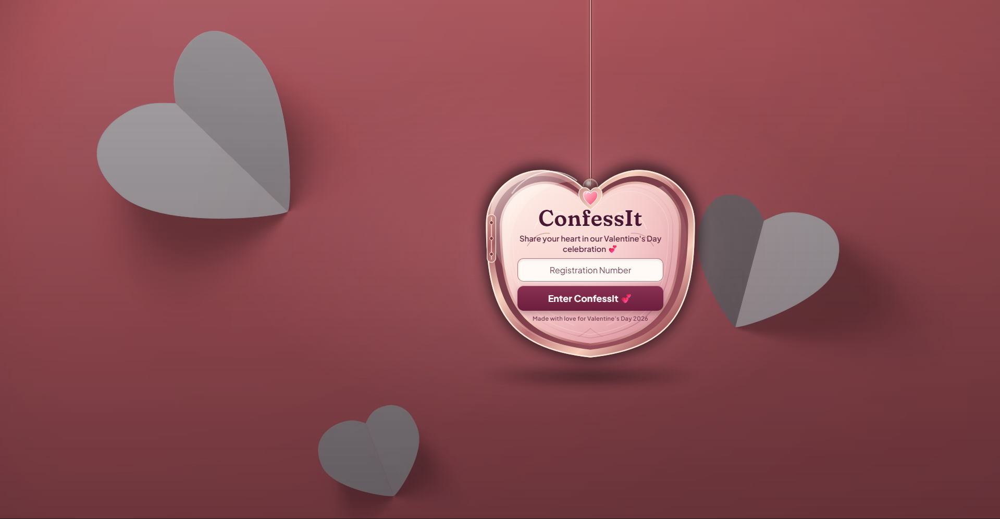
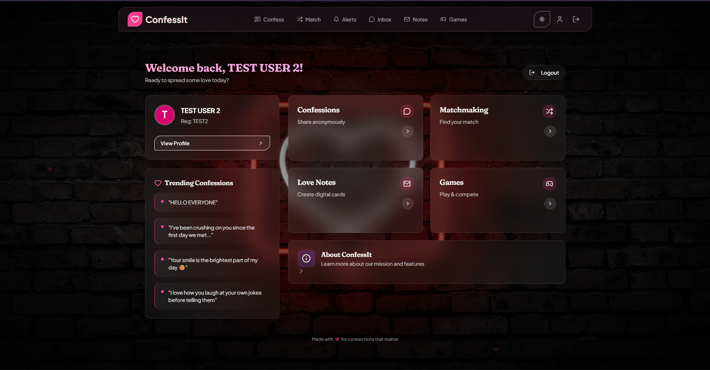
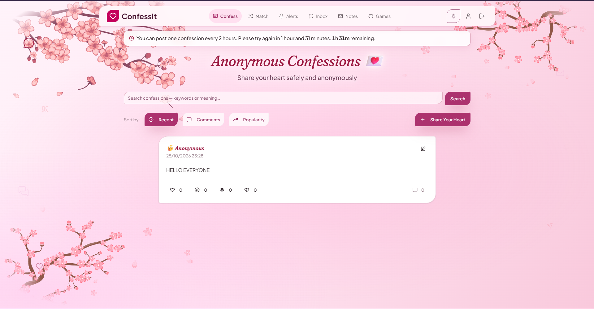
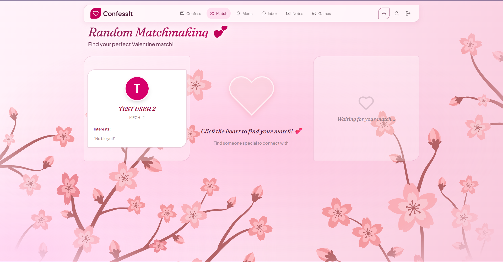
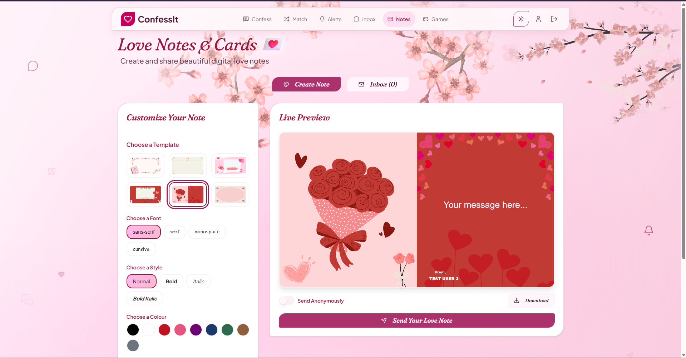
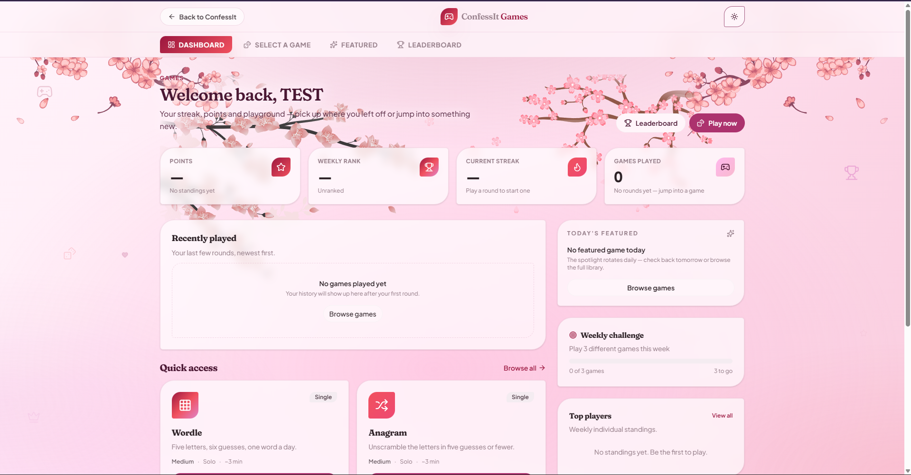
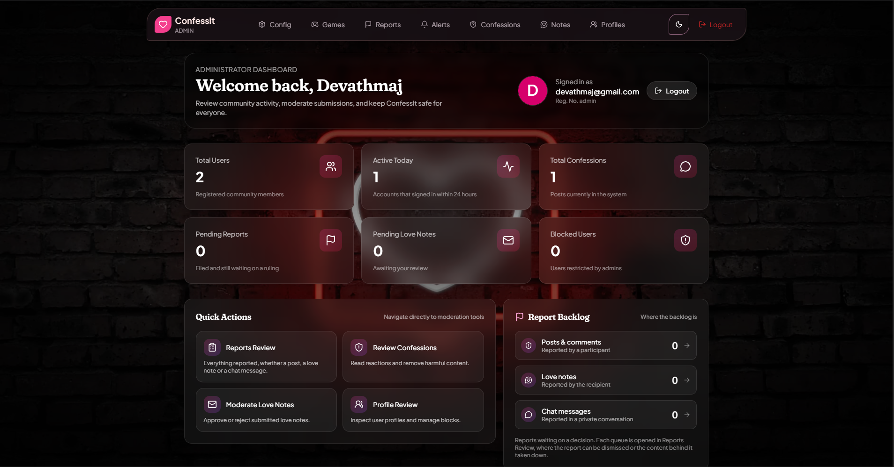
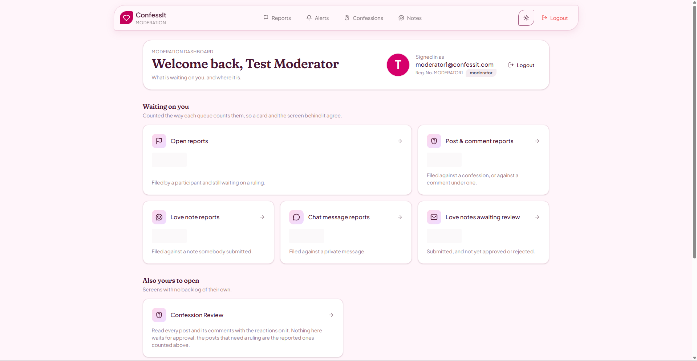
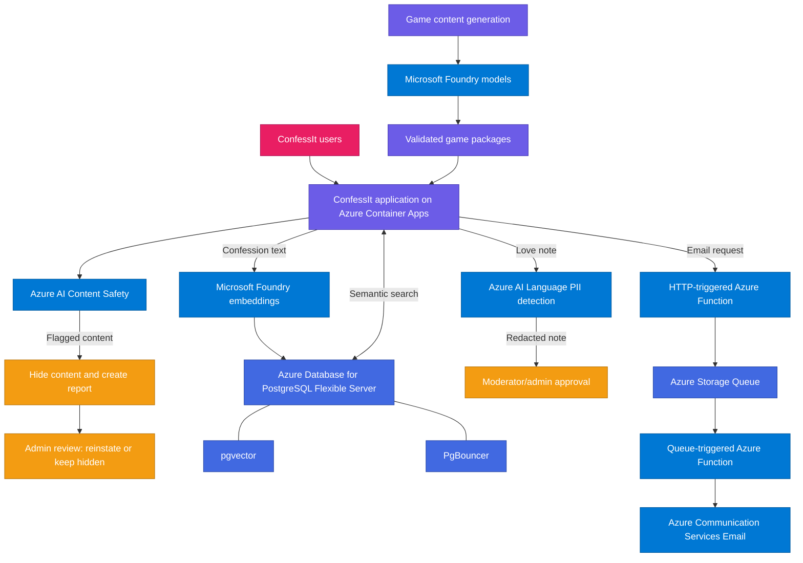

<h1 align="center">ConfessIt</h1>

  <em>An anonymous social and matchmaking platform built around confessions, private connections, love notes, and interactive games.</em>

  
  
  
  
  

  
  
  
  
  
  

---

## Overview

**ConfessIt** is a community-oriented social platform where people can share anonymous confessions, connect through matchmaking, send anonymous love notes, and play games together. It combines social features with moderation and privacy-focused workflows so that anonymous participation is supported by clear review controls.

The project brings together a user-facing application, administrative tools, AI-assisted features, and an Azure-hosted backend.

## Features

### Anonymous confessions

  
  
  

- Publish anonymous confessions and interact with posts through comments.
- Search confessions by meaning using semantic search, rather than depending only on exact keyword matches.
- Use automated content checks and a human review workflow for flagged confessions and comments.

### Matchmaking and private chat

  
  
  

- Matchmaking lets users discover a potential connection.
- When a match is established, users can invite one another to a private conversation.
- Conversations are time-limited. Chat messages pass through content moderation before they are encrypted for the application's chat-storage flow.

### Anonymous love notes

  
  
  

- Send anonymous love notes through a mandatory moderator/admin approval workflow.
- Personal information is detected and redacted before the note is presented for review, helping protect the sender's anonymity.

### Mini-games and couple games

  
  
  

ConfessIt includes individual and paired games, including **Case Closed** and **Plot Twist**, as well as games such as Wordle-style puzzles, Anagram, Couple Questionnaire, Reaction Time, Connections, and Trivia Drop.

Plot Twist uses an AI-assisted content-generation workflow: story packages are generated and validated before publication, while gameplay uses the published package instead of generating every choice live.

The scoring system supports daily, weekly, monthly, and all-time leaderboards, with separate scoring for individual and couple games.

### Moderation and administration

  
  
  

- Dedicated admin and moderator dashboards.
- A confession moderation page for reviewing reported or automatically hidden confessions.
- Flagged confessions, comments, and chat messages are hidden from the app and surfaced as reports for administrator review.
- An administrator can reinstate content when it was flagged by mistake or leave it hidden when it should remain unavailable.
- Uploaded profile images are checked by the image-moderation flow.

## Screenshots

The screenshots below walk through the main user experience and the administrative tools, with a short note on what each screen provides.

### User experience

#### Sign in

Users sign in to reach their personalized dashboard, confessions, matches, notes, and games. Authentication is required for the social and matchmaking features while confessions remain anonymous to the community.

#### Dashboard

The dashboard is the signed-in home screen. It surfaces the main areas of the app and gives users a quick way to reach confessions, matchmaking, love notes, and games.

#### Confessions

The confessions feed is where users publish anonymous posts, read others' confessions, and interact through comments. Semantic search helps surface related confessions even when the wording differs.

#### Matchmaking

Matchmaking presents users with a potential connection. Once a match is established, the two users can move into a time-limited private conversation that passes through content moderation.

#### Love notes

Love notes let users send anonymous messages. Every note goes through a moderator/admin approval step, and detected personal information is redacted before review.

#### Games

The games area hosts individual and couple games, including Case Closed, Plot Twist, Wordle-style puzzles, Anagram, Couple Questionnaire, Reaction Time, Connections, and Trivia Drop, with daily, weekly, monthly, and all-time leaderboards.

### Administration and moderation

#### Admin dashboard

The admin dashboard gives administrators an overview of the platform and access to the moderation and review tools they need to keep the community safe.

#### Confession moderation

The moderation page lists reported or automatically hidden confessions so a moderator or administrator can review the content and either reinstate it or leave it hidden.

## Technology stack

| Area | Technologies / services | Role in ConfessIt |
|---|---|---|
| Frontend | React | User-facing application and administrative interfaces |
| Backend | Python, FastAPI | Application APIs and backend workflows |
| Real-time communication | WebSockets | Live chat communication |
| Database | PostgreSQL | Relational application data and confession embeddings |
| Connection pooling | PgBouncer | Pools PostgreSQL connections |
| Vector search | `pgvector`, Microsoft Foundry `text-embedding-3-small` | Stores and searches confession embeddings semantically |
| Cache / supporting services | Redis | Backend support for application features |
| Containers | Docker, Azure Container Apps | Containerized development and Azure hosting |
| Observability | OpenTelemetry, Prometheus, Grafana | Instrumentation, metrics, and monitoring |
| AI and moderation | Microsoft Foundry, Azure AI Content Safety, Azure AI Language | Game-content generation, content checks, and PII redaction |
| Email delivery | Azure Functions, Azure Storage Queue, Azure Communication Services Email | Asynchronous application email delivery |

## Azure architecture

Azure supports several distinct parts of ConfessIt: application hosting, content moderation, privacy protection, semantic search, AI-generated game content, and asynchronous email delivery.

| Azure component | How ConfessIt uses it |
|---|---|
| **Azure Container Apps** | Hosts the containerized frontend and application services. HTTPS ingress and managed TLS certificates can secure a configured custom domain. |
| **Azure AI Content Safety** | Checks confession text, comments, chat messages, and uploaded profile images. Flagged confessions, comments, and chats enter the hide-and-report workflow. |
| **Microsoft Foundry — `text-embedding-3-small`** | Generates 1,536-dimensional embeddings for confession text. Comments are intentionally excluded from embedding generation. |
| **Azure Database for PostgreSQL Flexible Server** | Stores application data and confession embeddings. `pgvector` supports vector similarity search, and PgBouncer provides connection pooling. |
| **Azure AI Language PII detection** | Detects and redacts personal information from love notes before the redacted version is shown to a moderator/admin. |
| **Microsoft Foundry models** | Generate structured story and game content for Case Closed and Plot Twist, including choices, outcomes, results, and weights. |
| **Azure Functions** | Accepts email requests and processes queued email jobs through separate HTTP-triggered and queue-triggered functions in the same Function App. |
| **Azure Storage Queue** | Buffers email jobs so the main application request does not have to perform the entire delivery operation. |
| **Azure Communication Services Email** | Sends emails from the queue-processing workflow. |
| **Virtual Network (VNet)** | Provides the configured network environment for applicable Azure resources. Private connectivity depends on each service's network configuration; being in the same resource group does not by itself make resources private. |

### High-level architecture

### Asynchronous email delivery

Email delivery is separated from the main application's request path:

1. The application sends an email request to an HTTP-triggered Azure Function.
2. The function places the email job in Azure Storage Queue.
3. A queue-triggered function in the same Function App receives the job.
4. The worker calls Azure Communication Services Email to send the message.

This decouples accepting an email request from processing delivery. Queue acceptance alone does not mean that an email has reached the recipient's inbox.

### Moderation, privacy, and networking notes

- **Human review remains part of moderation.** Automated checks can hide content and create a report, but an administrator decides whether flagged confessions, comments, or chats should be reinstated or remain hidden.
- **PII redaction reduces exposure; it does not guarantee anonymity.** Indirect or unusual identifying details may still require human judgement.
- **Chat moderation precedes encryption in the application flow.** This description does not imply end-to-end encryption.
- **Network isolation depends on configuration.** A VNet associated with Container Apps does not automatically place every Azure service on the same private network.

For the detailed service-by-service explanation and official Microsoft documentation, see **[Azure architecture and service details](docs/azure.md)**.

## Project documentation

  
  

- [System architecture and runtime flows](docs/ARCHITECTURE.md)
- [Azure architecture and service details](docs/azure.md)
