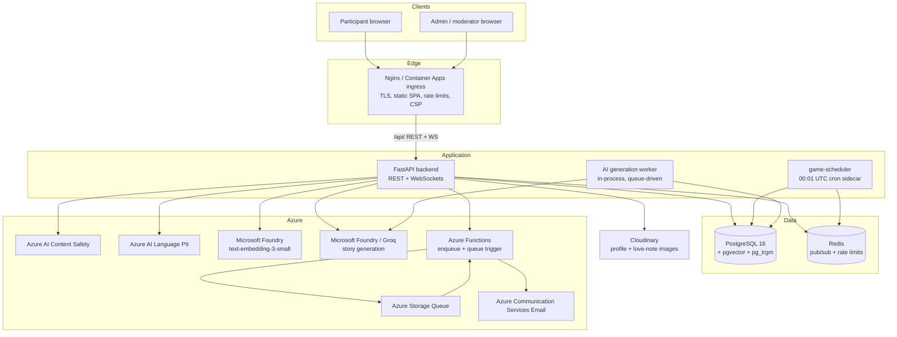
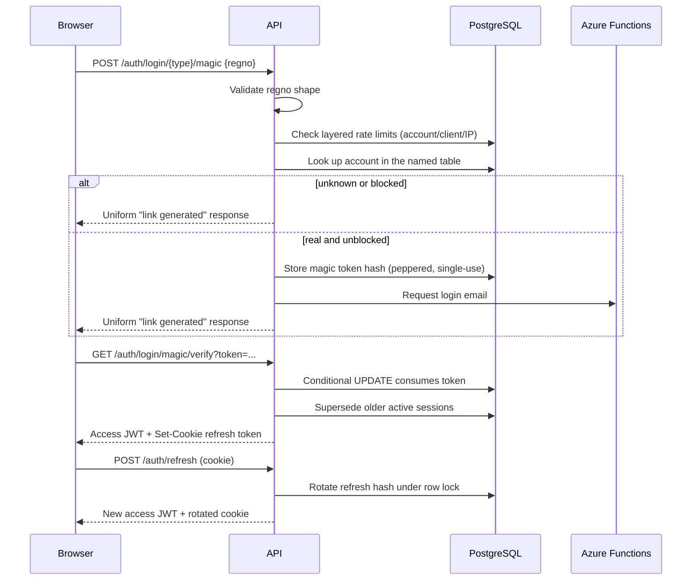
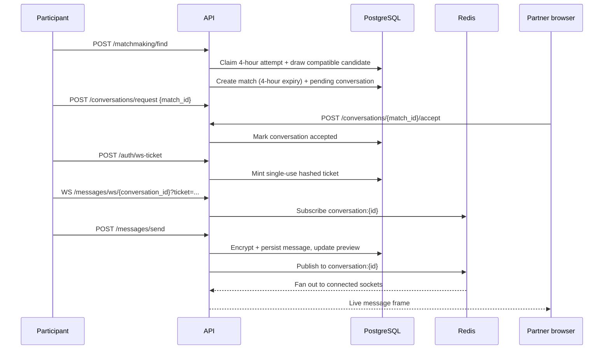
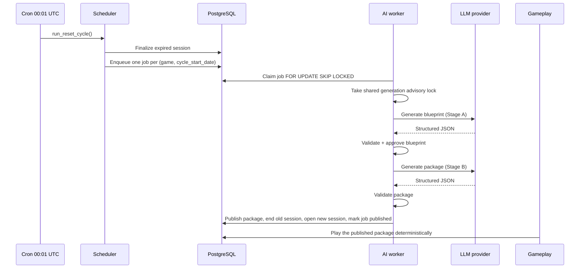
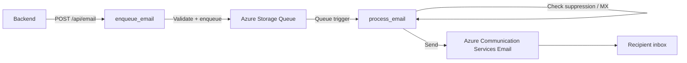
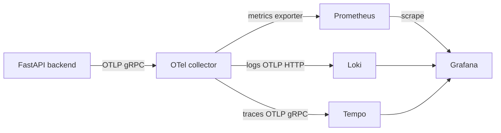

# ConfessIt Architecture

## 1. Purpose and scope

ConfessIt is a web application for anonymous confessions, matchmaking, love notes,
couples and individual games, moderation, and a small admin console. This document
describes:

- every runtime component and the responsibilities it owns;
- how the components connect and how a request moves through them;
- the main user, staff, game, AI-generation, and email flows;
- the data domains and the invariants that keep them consistent;
- the deployment, security, and observability model.

It intentionally stops short of documenting every endpoint, table column, or function.
Those details live in the code and in the existing `docs/azure.md`, `azure/README.md`,
and `README.md`.

---

## 2. System at a glance



The application has two distinct execution paths:

1. **Synchronous request path** - browser to Nginx to FastAPI to PostgreSQL,
   Redis, or an external provider. Most user actions live here.
2. **Background path** - the `game-scheduler` sidecar drives daily game rollovers,
   the in-process AI worker generates and publishes Plot Twist and Case Closed
   sessions, and Azure Functions deliver email asynchronously.

---

## 3. Runtime topology

### 3.1 Production Compose stack

`docker-compose.yml` is the reference production topology. It defines the
application services but expects PostgreSQL to be supplied externally.

| Service | Responsibility | Exposure |
|---|---|---|
| `nginx` | TLS termination, SPA static hosting, reverse proxy for `/api/`, WebSocket upgrade, edge rate limits, security headers | Host ports 80/443 |
| `backend` | FastAPI application: REST, WebSockets, auth, moderation, games, admin APIs | Compose network only |
| `game-scheduler` | Root-owned cron container that runs the game-reset script at 00:01 UTC, plus a catch-up pass at startup | Compose network only |
| `redis` | Pub/sub fan-out for live chat, global/login/WebSocket rate-limit counters, replay-notice gate | Compose network only |
| `otel-collector` | Receives OTLP traces, logs, and metrics from the backend; exports to Tempo, Loki, and Prometheus | Compose network only |
| `prometheus` | Scrapes the collector, the collector's own telemetry, and the backend `/metrics`; evaluates alert rules | Compose network only |
| `grafana` | Dashboards over Prometheus, Loki, and Tempo | Loopback `127.0.0.1:3000` |
| `loki` | Log storage | Compose network only |
| `tempo` | Trace storage | Compose network only |

PostgreSQL is deliberately not part of the production Compose file. The deployment
uses an external PostgreSQL server; Azure Database for PostgreSQL Flexible Server is
the documented managed option. The image must support `pgvector` and `pg_trgm`; the
backend creates both extensions at boot when the role is allowed to.

The Compose stack uses three bridge networks:

- `edge` - Nginx (which also serves the built SPA) and the backend.
- `app` - backend, scheduler, and Redis.
- `observability` - backend, scheduler, collector, Prometheus, Grafana, Loki, Tempo.

Only Nginx and loopback-bound Grafana are published. Everything else is reachable
only on the Compose network.

### 3.2 Development Compose stack

`docker-compose.dev.yml` keeps the same broad shape but adds live reload and a Vite
dev server:

- Nginx listens on loopback `:5173` for the SPA and `:8001` for the API.
- `frontend` runs Vite with source bind mounts and injects
  `VITE_API_URL=http://localhost:8001`.
- `backend` runs `uvicorn --reload`.
- Redis, the scheduler, and the observability stack are present and mirror
  production.
- PostgreSQL remains external, with connection settings in `backend/.env`.

The dev edge intentionally keeps the API on a separate origin. That preserves the
`/auth` cookie path and avoids collisions with SPA routes such as `/admin`,
`/profile`, and `/games`.

### 3.3 Azure deployment mapping

`docs/azure.md` describes the managed deployment. The mapping is:

| Platform component | Azure service |
|---|---|
| Frontend / API containers | Azure Container Apps |
| Ingress, HTTPS, custom domain | Container Apps ingress with a managed TLS certificate |
| Network isolation | Container Apps environment, optionally in a customer VNet |
| Relational data | Azure Database for PostgreSQL Flexible Server, PgBouncer, `pgvector` |
| Content moderation | Azure AI Content Safety (text and images) |
| Love-note PII redaction | Azure AI Language PII detection |
| Confession embeddings | Microsoft Foundry `text-embedding-3-small` |
| AI game content | Microsoft Foundry models (the code also supports Groq via configuration) |
| Email request acceptance and delivery | Azure Functions in one Function App |
| Email buffering | Azure Storage Queue |
| Email sending | Azure Communication Services Email |
| Email suppression state | Azure Table Storage |

The Nginx container remains the reference self-hosted edge. In Azure, Container Apps
ingress can provide the same external HTTPS entry point. The application itself is
unchanged by the hosting choice.

---

## 4. Repository map

| Path | Contents |
|---|---|
| `frontend/` | React single-page application, Vite build, Vitest tests, service worker, game artwork/templates |
| `backend/` | FastAPI application, domain services, SQLAlchemy models, tests, scheduler script, backend Dockerfiles |
| `azure/` | Azure Functions email pipeline, validation, delivery, suppression, tests |
| `nginx/` | Development and production Nginx configurations, TLS mount point |
| `observability/` | Prometheus, Loki, Tempo, OTel collector, Grafana provisioning, alert rules |
| `scripts/` | Operational SQL and replay helpers |
| `docs/` | Architecture and Azure documentation |
| `docker-compose.yml` | Production-oriented Compose stack |
| `docker-compose.dev.yml` | Development stack with live reload |
| `docker-compose.test.yml` | Test stack |
| `postgres-init.sql` | Creates the test database and installs `pgvector` |
| `.github/workflows/ci.yml` | Frontend and backend tests, dependency audits, SBOMs, Docker build validation |
| `.env` / `.env.example` | Compose-level infrastructure and deployment variables |
| `backend/.env` | Backend application settings |
| `backend/.scheduler.env` | Restricted scheduler settings: database, Redis, signing, cleanup; no chat encryption key |

---

## 5. Frontend architecture

### 5.1 Technology and entry point

The frontend is a React 19 + TypeScript single-page application built with Vite 8.
It uses:

- React Router 7 for routing and route guards;
- TanStack Query for server-state caching and invalidation;
- Axios for most HTTP calls;
- `fetch` for chat-adjacent requests that need explicit bearer handling;
- Tailwind CSS 4, shadcn-style Radix UI components, and Lucide icons;
- Sonner and the local toast components for feedback.

`src/main.tsx` mounts the application. `src/App.tsx` composes the global providers:

```text
QueryClientProvider
  TooltipProvider
    Toaster / Sonner
    AuthProvider
      GamesConfigProvider
        BrowserRouter
          RememberLastPage
          AppRoutes
```

The provider order matters:

- `AuthProvider` owns the current account, capabilities, login/logout, and session
  restoration.
- `GamesConfigProvider` owns the shared game catalogue/configuration read by both
  participant game pages and the admin game console.
- `BrowserRouter` sits inside those providers so route guards can read auth state.

### 5.2 Routes and access control

The SPA has three broad areas:

1. **Public**
   - `/login`, `/login/admin`, `/login/moderator`
   - `/verify-login`
2. **Participant**
   - `/dashboard`, `/confessions`, `/matchmaking`, `/inbox`, `/notifications`,
     `/profile`, `/love-notes`, `/about`, and the `/games/*` section
3. **Staff**
   - `/admin/*` - admin console, queues, configuration, games, featured schedule,
     leaderboards
   - `/moderation/*` - moderator hub and moderator notification inbox

Route guards in `App.tsx` are convenience and layout protection, not the security
boundary:

- `PublicOnlyRoute` sends an already signed-in account to its landing page.
- `ProtectedRoute` requires a session.
- `ParticipantOnlyRoute` excludes staff accounts from participant screens.
- `CapabilityRoute` requires a named capability and can exclude a second capability
  (used to keep `/moderation` off an admin's map).

Every guarded operation is re-checked on the backend. Hiding a screen in the SPA does
not grant or deny access.

The landing page is derived from capabilities:

- admin-level capabilities -> `/admin`
- moderation capabilities -> `/moderation`
- otherwise -> `/dashboard`

Separate login doors exist because a registration number is unique only within one
of the three account tables (`users`, `admin`, `moderator`).

### 5.3 Authentication state and token lifecycle

The frontend uses a deliberately split credential model:

- **Access token**: a short-lived JWT held only in module memory
  (`src/lib/tokenStore.ts`). It is never written to `localStorage`,
  `sessionStorage`, or a JS-readable cookie. A reload restores the session through
  a silent refresh, not by reading persisted state.
- **Refresh token**: an HttpOnly, `SameSite=Lax` cookie scoped to `/auth`. The
  browser cannot read it, and the server rotates it on every use.
- **WebSocket ticket**: a short-lived, single-use ticket obtained from
  `/auth/ws-ticket` and passed in the socket query string. The longer-lived access
  token is never placed in a URL that the server logs.

On startup, `AuthContext` attempts a silent `POST /auth/refresh`. A successful refresh
returns a fresh access token and the account shape, so the app does not need a second
`/auth/me` round trip. A transport failure is treated differently from a rejected
token: the app retries a failed read but only ends the session when the server
actually rejects the credential.

Axios has a single-response interceptor that:

- detects a 401 from a non-auth route;
- performs one shared refresh;
- replays the original request once;
- ends the session only when the refresh or the replay is also refused.

Chat paths that use `fetch` use `authorizedFetch`, which implements the same
refresh-and-replay contract. This is necessary because a long-lived chat page can
outlive the access token.

### 5.4 API and WebSocket addressing

`src/lib/apiBase.ts` defines one API origin for every call:

1. `VITE_API_URL` when present (baked in at build time; production builds enforce
   HTTPS);
2. the page origin with the dev port swapped in a production bundle;
3. `http://localhost:8001` in development and tests.

The WebSocket origin is derived from the same value by changing `http` to `ws` or
`https` to `wss`. This prevents REST and WebSocket traffic from disagreeing about the
backend address.

### 5.5 Service worker and image handling

`public/sw.js` caches only:

- immutable static assets and SPA files;
- public profile pictures, with a bounded freshness window.

It explicitly refuses to cache API, auth, admin, staff, report, chat, and conversation
traffic. Cache names are versioned, and activation deletes old `confessit-*` caches.
Fetched profile images are cleared on logout-related messages.

Love-note images are private Cloudinary objects. The backend mints signed delivery
URLs only when the viewer is entitled; the frontend never holds a durable image URL
of its own.

### 5.6 Frontend domain surfaces

| Area | Main pages/components |
|---|---|
| Auth | `Login`, `MagicLinkVerification`, `AuthContext` |
| Participant dashboard | `UserDashboard`, `Index` |
| Confessions | `ConfessionsPage`, `ConfessionBody` |
| Matchmaking and chat | `MatchmakingPage`, `InboxPage`, `MessageBoxPage`, `ConversationDialog` |
| Love notes | `LoveNotesPage`, `ReportLoveNoteDialog` |
| Profile | `ProfilePage`, `ProfileAvatar` |
| Games | `GamesLayout`, `GamesDashboardPage`, `GamesSelectPage`, `GamesFeaturedPage`, `GamesLeaderboardPage`, and one page per game |
| Staff moderation | `AdminDashboard`, `ModeratorDashboard`, `ConfessionsAdmin`, `ReportsReview`, `LoveNotesReview`, `ProfileReview`, `StaffNotificationsPage` |
| Admin game console | `AdminGamesLayout`, `AdminGamesDashboard`, `AdminGamesManage`, per-game config pages, `AdminFeaturedManage`, `AdminGamesLeaderboard` |
| Shared games UI | `GameCard`, `GameCategorySection`, `PartnerPicker`, `StatCard`, per-game config components |

---

## 6. Backend architecture

### 6.1 Technology and entry point

The backend is a FastAPI application served by Uvicorn. It uses:

- SQLAlchemy 2 with `psycopg` 3 against PostgreSQL;
- Pydantic 2 / pydantic-settings for request models and configuration;
- Redis for pub/sub and rate limits;
- OpenTelemetry for traces, logs, and metrics;
- Cloudinary for image storage;
- Azure REST/SDK clients for moderation, PII, embeddings, and email;
- Groq or an OpenAI-compatible Microsoft Foundry endpoint for story generation.

`app/main.py` is the application entry point. It creates the FastAPI app, installs
middleware and exception handlers, registers every router, initializes telemetry,
and owns the startup/shutdown lifecycle.

### 6.2 Startup and shutdown lifecycle

Startup performs, in order:

1. Install log redaction for query-string credentials.
2. Acquire the process-wide PostgreSQL client and wait for connectivity.
3. Validate Cloudinary configuration; love-note image delivery must be private.
4. Validate the chat encryption key configuration.
5. Converge the database schema under the schema advisory lock.
6. Seed the Couple Questionnaire question bank idempotently.
7. Ensure current game sessions exist, using the same idempotent reset path as cron.
8. Check whether a Trivia Drop question is live or scheduled and notify staff if not.
9. Start the in-process AI generation worker when enabled.
10. Initialize matchmaking slots.
11. Instrument SQLAlchemy, Redis, and urllib3 after schema work.
12. Start a task that republishes the game-reset heartbeat metric.

Shutdown stops the AI worker, cancels the heartbeat task, disposes the database
engine, and closes the Redis pools.

### 6.3 Middleware pipeline

Middleware is added in this order, which makes the last-added run outermost:

```text
SecurityHeadersMiddleware        (outermost)
HttpCacheMiddleware
ProxyHeadersMiddleware           (only when TRUSTED_PROXY_HOSTS is set)
TrustedHostMiddleware
GlobalRateLimitMiddleware
CORSMiddleware
RequestBodyLimitMiddleware
HTTPRequestTimeoutMiddleware     (innermost)
FastAPI routing / WebSockets
```

Responsibilities:

| Middleware | Role |
|---|---|
| `SecurityHeadersMiddleware` | Adds `nosniff`, frame denial, `no-referrer`, Permissions-Policy, COOP, CORP, CSP, and HSTS on HTTPS |
| `HttpCacheMiddleware` | Applies cache policy after the response exists |
| `ProxyHeadersMiddleware` | Trusts `X-Forwarded-*` only from configured proxy networks |
| `TrustedHostMiddleware` | Rejects Host headers outside `ALLOWED_HOSTS` |
| `GlobalRateLimitMiddleware` | Per-IP Redis flood brake shared by all workers; fails open on Redis outage |
| CORS | Exact origins, credentialed requests, limited methods/headers, `Retry-After` exposed |
| `RequestBodyLimitMiddleware` | Rejects declared or streamed bodies over the configured ceiling |
| `HTTPRequestTimeoutMiddleware` | Bounds each HTTP request, including body reads and response generation |

Exception handlers convert validation errors, matchmaking refusals, and game
availability refusals into stable JSON shapes. WebSockets are excluded from the HTTP
timeout and body-limit middleware and have their own handshake, idle, and
authorization rules.

### 6.4 Layering and dependencies

The backend follows a router -> service -> persistence layout:

- **Routers** (`app/routers/`) own HTTP/WebSocket concerns, request validation,
  authentication dependencies, status codes, and response models.
- **Services** (`app/services/`) own business rules, transactions, locking,
  idempotency, and provider calls.
- **Models** (`app/models.py`, `app/db_models.py`) split API shapes from database
  tables and relationships.
- **Configuration** (`app/config.py`) is a single validated settings object.
- **Shared primitives** include capabilities, limits, authorization, logging,
  telemetry, cache policy, and HTTP helpers.

There is no separate repository layer. Services use SQLAlchemy sessions directly
because many operations depend on transaction-scoped locks, conditional updates, and
savepoints that a generic repository would obscure.

### 6.5 Database access and schema convergence

`app/postgres.py` owns one process-wide engine per process and provides SQLAlchemy
sessions. Key properties:

- UTC session timezone.
- Pool size, overflow, timeout, recycle, and statement timeout are configurable and
  validated against the expected worker count.
- `pool_pre_ping` avoids handing out stale sockets.
- `SET LOCAL statement_timeout` is used inside each transaction because Azure
  PgBouncer rejects it as a startup option.
- A separate `NullPool` connection holds the schema-init advisory lock.

There is no Alembic. Schema convergence happens at boot through `PostgresClient.initialize()`:

- `create_all` creates missing tables;
- missing columns are added;
- retired columns are dropped from a named list;
- model-declared unique indexes are added;
- CHECK constraints are added `NOT VALID` and superseded families are dropped;
- `pg_trgm` GIN indexes are installed best-effort;
- `vector` is installed and an HNSW cosine index is attempted;
- NOT NULL constraints are tightened with a regno-derived placeholder backfill where
  required;
- widened columns are altered;
- session deadlines and staff notification preferences are backfilled;
- legacy game tables converge to the current session lifecycle;
- Trivia Drop's single-active-question rule is installed;
- automated report source columns and partial unique indexes converge.

The whole sequence is serialized by a fixed schema advisory lock. DDL that another
worker already applied is tolerated by SQLSTATE code, not by message text.

### 6.6 Authentication and authorization

Three account tables are the source of truth:

- `users` - participants;
- `admin` - staff with moderation and platform-administration capabilities;
- `moderator` - staff with moderation capabilities only.

`app/accounts.py` defines capabilities and maps each account type to a set. Routes
depend on either `require_participant` or `require_capability(...)`; the current
account is always re-read from PostgreSQL, so privileges are never taken from JWT
claims alone.

The magic-link login flow is:



Important properties:

- The login response is uniform for real, unknown, and blocked accounts, so the
  endpoint is not an account-existence oracle.
- Rate limits are layered: account cooldown, account long window, browser client,
  and IP.
- A magic link is single-use by conditional update. A continuity check compares the
  mint and redemption subnets/user agent; mismatches are counted and refused
  uniformly.
- One live session per account. A newer login supersedes older sessions under a
  per-account advisory lock.
- Access tokens are fixed-algorithm HS256 and carry `account_id`, `account_type`,
  and `session_id`.
- The refresh token is stored only as a peppered, domain-separated hash. Rotation is
  single-use; replay is counted, logged, and optionally notified, but the live session
  is not killed by a benign racing tab.
- Blocking an account revokes its sessions and unredeemed magic links.
- The WebSocket ticket is hashed, single-use, bound to a session, and expires in 60
  seconds.

### 6.7 Domain components

#### Profiles and images

- Participants can update profile fields and upload one profile picture.
- Uploads are validated by decoded format, byte size, dimensions, and pixel count.
- Profile pictures are public Cloudinary objects; the URL is derived from stored
  identity at read time.
- A per-account cooldown limits picture replacement.
- Staff have no participant profile row and are handled by the shared account shape.

#### Confessions and comments

- A participant may create one confession per two-hour cooldown, claimed by a
  conditional UPDATE.
- The confession body is moderated by Azure AI Content Safety before persistence.
  Moderation failure aborts creation rather than storing unmoderated content.
- Flagged confessions are stored hidden and an automated report is created for staff.
- Comments use the same moderation flow.
- Reactions and comment likes/dislikes are counters on stored rows.
- Removed content is soft-deleted with `removed_at`; public reads exclude it, staff
  reads include and flag it.
- New confessions are embedded synchronously and best-effort. A failed embedding
  leaves the confession visible but absent from semantic search.

#### Hybrid search

Search combines two signals in one response:

- **Keyword**: `pg_trgm` similarity and recency over confession body and recipient
  name.
- **Semantic**: a query embedding from Azure `text-embedding-3-small` (1536
  dimensions), cosine-distance search over `pgvector`, a configured similarity floor,
  and top-K limiting.

The two halves run concurrently and are deduplicated so a confession appears once.
Semantic status is explicit: `ok`, `disabled`, `unavailable`, `rate_limited`, or
`skipped_short`. A semantic failure degrades to keyword results rather than failing
the request. Public search excludes removed content and never matches identity;
staff search includes removed content and staff columns.

#### Love notes

- A participant sends a note to another participant, optionally with an image.
- The image is stored as a private Cloudinary object; the note remains pending until
  a moderator decides.
- Azure AI Language PII detection scans the body and produces a redacted moderation
  preview. The preview is stored once at creation; a failure stores no preview and
  never the raw body as a fallback.
- Moderators see the redacted preview, note metadata, and reports. They can approve,
  reject, delete, or re-run redaction.
- Only an approved note proceeds through the delivery workflow. Recipients see it in
  their inbox and can report it.
- Signed image URLs are minted only after entitlement checks; they are not stored in
  logs or responses for unauthorized viewers.

#### Matchmaking, conversations, and live chat



- Matchmaking is mutual selection within configurable slots/cohorts. A match expires
  four hours after creation.
- A conversation must be accepted before messages can be sent.
- Message bodies are moderated before encryption.
- Chat bodies are encrypted at rest with versioned AES-256-GCM keys. Stable metadata
  is authenticated as associated data. Conversation previews are encrypted copies of
  the newest visible message.
- Redis pub/sub provides live fan-out. PostgreSQL remains the durable transcript.
- A live socket is revalidated per frame and when forwarding a message. Revoked,
  expired, blocked, or superseded sessions stop receiving.
- The thread can be read after it is terminated; writes are refused.
- Reported messages are separately captured as encrypted evidence with their own
  retention window and an access audit trail.
- The daily cleanup job purges expired matchmaking messages, Case Closed messages,
  and expired evidence in bounded batches.

#### Notifications

There are two notification families:

- **Participant notifications** (`notifications`) - stored in-app and optionally
  emailed when the participant's `notifications_enabled` is true.
- **Staff notifications** (`staff_notifications`) - one inbox per staff role, with
  category preferences for reports, love notes, and games. A moderator is never
  emailed game notifications regardless of the stored preference.

An in-app notification commits before email is attempted. Email failure never rolls
back or raises out of the stored notice. Notification targets are limited to known
kinds (`conversation`, `love_note`) and carry both a kind and an id, or neither.

#### Games platform

`game_configs` is the shared catalogue for all games. Each game has one row with:

- `enabled` and `is_hidden` availability switches;
- `content_mode` (`random` or `manual`, where applicable);
- `reset_cadence` (`daily`, `every_2_days`, `every_3_days`, `every_5_days`,
  `weekly`);
- game-specific settings such as Two-Key Escape grid size;
- AI difficulty for Plot Twist and Case Closed.

The eight period-based games follow the same session lifecycle:

- at most one `active` or `pending` session per game, enforced by a partial unique
  index;
- `ended` sessions are retained as history and keep player progress;
- session boundaries are computed in UTC by `game_periods.py`;
- gameplay writes take the game's transaction-scoped advisory lock so a scheduler
  rollover cannot race a play;
- a featured spotlight is a separate per-date schedule, capped at seven consecutive
  days for one game, and never drives session creation.

Trivia Drop is the exception: it has no period session, only at most one `active`
question at a time (also enforced by a partial unique index), with drafts and
scheduled questions waiting behind it.

The games are:

| Game | Model and mechanics |
|---|---|
| **Wordle** | One word per period, six guesses, per-player participation rows, keyboard/scoring feedback |
| **Anagram** | One word per period, timed attempts, active/pause/heartbeat tracking, per-player rows |
| **Connections** | Manual 16-word, 4-group puzzle; scheduled puzzles; submissions record correct groups/words |
| **Trivia Drop** | Single active question at a time; options, partial-credit submissions, scheduled/deployed/rescheduled/cancelled states |
| **Couple Questionnaire** | Mutual partner selection, seeded question bank, shared and per-player questions, answers, predictions, pair sessions |
| **Two-Key Escape** | Couple maze with navigator/key-operator roles, transactionally enforced moves and key charges, per-couple sessions |
| **Reaction Time** | Fixed per-session submission budget, server-measured attempts, best/average derived from stored submissions |
| **Plot Twist** | Published AI story package executed deterministically; alternating choices, state, flags, endings, treasure, seeded per session |
| **Case Closed** | Published AI case package; couple investigation, evidence, chat, accusation proposal/confirmation, time-decay scoring |

Game rules and limits are centralized in `app/limits.py` and mirrored in
`frontend/src/lib/limits.ts` where the UI needs them.

#### League and leaderboards

- Every opened game session or released Trivia question is snapshotted as a league
  opportunity before play.
- When an event closes, a repair scan finalizes it: results are ranked, normalized to
  a 0-100 base, weighted by whether the game was featured, and written as awards.
- Awards are the source of truth for individual, couple, per-game, category, and
  all-time leaderboards.
- Finalization is idempotent and lock-protected. Reprocessing supersedes live awards
  and issues replacements.
- Global scoring profiles differ per game but always produce an absolute, comparable
  base score rather than a session-relative score.

#### Admin console

The admin console and moderation screens read and write through dedicated routers:

- `admin.py` - confessions, comments, reports, users, account creation/blocking,
  bulk upload, stats, configuration, and message reports.
- `admin_love_notes.py` - love-note queue, status changes, deletion, redaction retry,
  and reports.
- `admin_games.py` - catalogue config, featured spotlight, reset trigger, leaderboard
  finalization/reprocessing, stats, and admin boards.
- `admin_wordle.py`, `admin_anagram.py`, `admin_connections.py`,
  `admin_couple.py`, `admin_trivia_drop.py`, `admin_reaction_time.py`,
  `admin_plot_twist.py`, `admin_case_closed.py` - per-game pipelines and recovery
  surfaces.
- `staff_notifications.py` - staff inbox, unread count, preferences, and read state.

All staff routes are capability-gated. The client's route guard is duplicated on the
server, so bypassing the SPA grants nothing.

### 6.8 AI game generation architecture

Plot Twist and Case Closed are generated ahead of play. Runtime gameplay never calls
a language model.

The pipeline is:



Important properties:

- The scheduler tick is a checkpoint, not a generation deadline. The playable session
  opens only after the worker publishes a validated package.
- `game_generation_jobs` has unique `(game_id, cycle_start_date)` and states
  `queued`, `running`, `retry_wait`, `published`, `failed`, `cancelled`.
- Jobs are claimed with `FOR UPDATE SKIP LOCKED`; stale `running` jobs are reclaimed
  after a timeout. Duplicate delivery and a crashed worker are safe.
- A shared PostgreSQL advisory lock serializes the two games across all workers and
  replicas. Generation is never concurrent, even on separate processes.
- Publication is one transaction under the game's lifecycle lock. It re-checks the
  job, hidden state, revocation, and package validity; ends the old session
  (finalizing Case Closed first); opens the new period; snapshots the league
  opportunity; and completes the job.
- Failures retry with linear backoff up to a configured maximum, then park as
  `failed` with a provider-safe error. The next cycle starts clean and one game's
  failure never blocks the other.
- Difficulty and cadence are snapshotted when a cycle is enqueued, so a mid-flight
  admin change applies to the next session.
- Revoking a session ends the live session or cancels the in-flight job, opens no
  replacement, and records a `game_session_revocations` row that suppresses that
  cycle. Hide, disable, and revoke are distinct controls.
- Blueprint/package admin routes remain as internal recovery surfaces; normal
  operation is unattended.
- The provider is configuration, never a code change: `groq` (default) or
  `foundry`/openai-compatible. The client uses strict JSON Schema when available,
  local validation always, and never silently reroutes to the other provider.

### 6.9 Background processing

| Process | Trigger | Work |
|---|---|---|
| `game-scheduler` | Container start catch-up, then cron at 00:01 UTC | `scripts/run_game_resets.py` -> `run_reset_cycle()` |
| `run_reset_cycle` | Scheduler | Per-game session rollover, Trivia release, league finalization, chat retention, heartbeat |
| AI generation worker | Poll loop inside each API process when enabled | Claim and run generation jobs |
| Reset heartbeat task | Every 60 seconds inside each API process | Read the last reset outcome and publish metrics |
| Azure Functions | HTTP request and Storage Queue message | Validate/enqueue email and send via ACS |
| Boot convergence | API startup | Seed idempotent content, ensure sessions, initialize slots |

The scheduler is a small one-shot process per tick, not a long-running application
server. It builds a restricted environment, waits for the database, runs one cycle,
and exits. A repeated run is safe because every game evaluation is idempotent.

---

## 7. External services and integrations

### 7.1 Azure AI Content Safety

Used for confession text, confession comments, matchmaking chat messages, Case Closed
messages, and profile images.

- Text uses the Analyze Text API with a pinned API version.
- Each content type has a central severity policy.
- For text, severity at or above the configured threshold creates an automated report
  and hides the row from participants; staff decide whether to reinstate or keep it
  hidden.
- Profile pictures are blocked before storage when they violate policy; staff are
  notified.
- Moderation failure is treated as an outage for confession, comment, and chat
  creation rather than a silent bypass. Chat moderation runs before encryption.

### 7.2 Azure AI Language PII detection

Used only for love-note moderation previews. The service detects and redacts personal
information before a moderator sees the note. Redaction is a privacy aid, not a
guarantee of anonymity; the moderator still makes the approval decision.

### 7.3 Microsoft Foundry embeddings and pgvector

- Model: `text-embedding-3-small`.
- Dimensions: 1536.
- Storage: `confession_embeddings.embedding` as `vector(1536)`.
- One embedding per confession, written once on creation. Comments, identities,
  reports, and moderation data are never embedded.
- Search uses cosine distance (`<=>`); `1 - distance` is cosine similarity.
- The provider is called through a bounded HTTP client with retries. A provider
  failure degrades search; it never blocks confession creation indefinitely.

### 7.4 LLM provider for games

`app/services/llm_client.py` is a provider-neutral structured-JSON client:

- `LLM_PROVIDER=groq` uses Groq's API.
- `LLM_PROVIDER=foundry` uses the OpenAI SDK against a Microsoft Foundry
  OpenAI-compatible endpoint.
- Legacy spellings `openai` and `auto` remain accepted.
- Requests use strict JSON Schema when supported and a JSON-object fallback when not.
- Every response is validated locally against the game's Pydantic schemas before
  publication.
- Errors are provider-safe and never expose keys or raw request bodies.

### 7.5 Azure Functions, Queue Storage, and ACS Email



- The backend only needs `EMAIL_FUNCTION_URL`; it never receives Storage or ACS
  credentials.
- `enqueue_email` validates the request, writes JSON to the queue, and returns 202.
  It never sends email.
- `process_email` validates again, checks suppression, checks recipient MX records,
  and sends through ACS.
- Supported types are `login`, `notification`, and `account_blocked`.
- Transient failures are re-raised for the Functions retry policy and eventually
  reach the poison queue. Permanent recipient failures are recorded in Table Storage
  suppression.
- Queue semantics are at-least-once, not exactly-once. The pipeline does not consume
  delivery receipts, so a successful send is not proof of inbox delivery.
- The backend decides who may receive a notification before posting. The Function App
  has no access to the application database.

### 7.6 Cloudinary

- Profile pictures are public `upload` objects.
- Love-note images are `authenticated` objects served through signed delivery URLs.
- The API secret signs delivery URLs, so all three Cloudinary credentials are
  required for the application to boot.
- Signed love-note URLs do not expire on the current plan. The application therefore
  re-checks entitlement on every response that mints one and treats the URL as a
  bearer capability.

### 7.7 Redis

Redis is not a durable store. It provides:

- conversation and Case Closed pub/sub channels;
- global, WebSocket handshake, and login rate-limit counters;
- the hour-long gate for refresh-replay notifications.

Two pools are used:

- a command pool for short-lived operations;
- a subscriber pool whose ceiling is the number of concurrent live chats one worker
  can serve.

This prevents a busy chat from starving publishes or rate limiting.

---

## 8. Data model overview

Tables are created and converged from SQLAlchemy models. They group into these
domains.

### Accounts and sessions

`users`, `admin`, `moderator`, `login_tokens`, `websocket_tickets`,
`login_rate_limits`, `staff_notification_preferences`.

- `login_tokens` doubles as the session record: magic-link consumption, absolute
  session deadline, refresh hash, supersession/revocation state, and device metadata.
- Tokens are stored only as peppered hashes with a domain separator.

### Confessions and search

`confessions`, `confession_comments`, `confession_embeddings`, `reports`.

- Removed content uses `removed_at` rather than deletion.
- `confession_embeddings` has a unique confession id and cascade delete.
- `reports` supports both human reporters and automated system reports.

### Love notes

`love_notes`, `love_note_templates`, `love_note_reports`.

- The raw body and the redacted moderation preview are separate fields.
- Image identity is stored, not a durable public URL.

### Matchmaking and messaging

`matches`, `conversations`, `messages`, `message_reports`,
`chat_message_evidence`, `chat_evidence_access`, `notifications`,
`matchmaking_slots`.

- Chat bodies and previews store ciphertext, nonce, and key version.
- Evidence is separately encrypted and has its own retention deadline.
- `notifications` supports optional typed targets and read state.

### Games

Shared tables:

- `game_configs`
- `featured_games`
- `scheduled_game_contents`
- `game_score_opportunities`
- `game_score_awards`
- `game_generation_jobs`
- `game_session_revocations`
- `game_reset_heartbeats`

Per-game tables:

- Wordle: `wordle_games`, `wordle_user_games`
- Anagram: `anagram_games`, `anagram_user_games`
- Connections: `connections_games`, `connections_words`,
  `connections_submissions`, `connections_scheduled_puzzles`
- Couple Questionnaire: `couple_games`, `couple_game_questions`,
  `couple_game_answers`, `couple_game_selections`, `couple_game_sessions`,
  `couple_game_session_questions`, `couple_game_session_answers`,
  `couple_game_session_predictions`
- Two-Key Escape: `two_key_escape_games`, `two_key_escape_sessions`
- Reaction Time: `reaction_time_games`, `reaction_time_submissions`
- Trivia Drop: `trivia_drop_questions`, `trivia_drop_options`,
  `trivia_drop_submissions`
- Plot Twist: `plot_twist_blueprints`, `plot_twist_packages`,
  `plot_twist_games`, `plot_twist_sessions`, `plot_twist_decisions`
- Case Closed: `case_closed_blueprints`, `case_closed_packages`,
  `case_closed_games`, `case_closed_sessions`, `case_closed_investigations`,
  `case_closed_evidence`, `case_closed_messages`,
  `case_closed_message_reports`

### Staff notifications

`staff_notifications`, `staff_notification_reads`,
`staff_notification_preferences`.

---

## 9. Consistency, concurrency, and idempotency

The application relies on PostgreSQL for correctness, not on in-memory flags.

| Concern | Mechanism |
|---|---|
| Schema changes across booting workers | Schema advisory lock |
| Game reset racing admin changes | Per-game advisory lock |
| Gameplay racing a game rollover | Transaction-scoped game lock in gameplay writes |
| AI generation across workers/replicas | Shared session-level advisory lock |
| Only one active AI generation job per game/cycle | Unique `(game_id, cycle_start_date)` |
| Only one active game session | Partial unique index on `(1)` where status is active/pending |
| Only one active Trivia question | Partial unique index on `(1)` where status is active |
| Magic link single use | Conditional UPDATE |
| Refresh rotation single use | Conditional UPDATE keyed on hash |
| One live session per account | Per-account advisory lock + supersession update |
| Confession cooldown | Conditional UPDATE on `last_confession_at` |
| Matchmaking cooldown | Conditional UPDATE on `last_matchmaking_at` |
| League finalization | Per-opportunity lock + idempotent award ledger |
| Duplicate queue delivery | Job status checks, row locks, convergent publication |
| Email delivery | At-least-once queue semantics; retries and poison queue |

The code prefers database-enforced invariants over application-only checks because
scheduler ticks, API workers, and admin actions can all run concurrently.

---

## 10. Security and privacy architecture

### 10.1 Trust boundaries

- The browser is untrusted.
- Nginx / Container Apps ingress is the public edge.
- The backend is the authorization and business-rule boundary.
- PostgreSQL, Redis, and the observability services are internal.
- Azure providers, Cloudinary, Groq/Foundry, and the Function App are external
  services reached over the network.

### 10.2 Authentication and authorization

- Magic-link passwordless login only; no password grant.
- Short-lived access JWT, HttpOnly refresh cookie, single-use WebSocket ticket.
- Session state, account state, block state, and supersession are re-read per
  request.
- Capabilities are server-owned; the client only mirrors them for navigation.
- Staff and participants are separated by account table and capability.
- Blocked accounts cannot sign in, refresh, or receive notifications.

### 10.3 Transport and browser hardening

- Production Nginx terminates TLS and redirects HTTP to HTTPS.
- HSTS, `nosniff`, frame denial, no-referrer, Permissions-Policy, COOP, CORP, and CSP
  are sent by the edge and by the backend.
- The SPA CSP allows first-party scripts/styles, Google Fonts, Cloudinary images and
  media, `data:`/`blob:` previews, and the API origin over HTTPS/WSS.
- Unknown Host headers are refused by the backend and unknown names are refused at
  the edge.
- The edge rate limits abuse before it reaches the application; the backend adds its
  own per-IP and per-endpoint limits.

### 10.4 Data protection

- Chat content is encrypted at rest with versioned AES-256-GCM keys.
- Chat evidence is separately encrypted with a separate retention window.
- Magic-link and refresh tokens are stored only as peppered hashes.
- Access tokens are in memory only in the browser.
- Sensitive log fields are redacted or hashed; query strings carrying tokens are
  stripped from edge access logs and OTel spans.
- Cloudinary love-note delivery uses signed URLs and entitlement checks.
- PII redaction reduces, but does not guarantee, anonymity in love notes.
- Automated moderation hides first; a human decides whether content is reinstated.
- Secrets live in environment files or the platform secret mechanism, never in the
  repository. The scheduler gets a restricted environment without chat keys or
  unrelated backend credentials.

### 10.5 Abuse controls

- Nginx edge rate limits.
- Backend global per-IP flood brake, fail-open on Redis outage.
- Layered login limits on account, long account window, browser client, and IP.
- WebSocket handshake flood brake.
- Confession and matchmaking cooldowns.
- Request body size limit and per-request timeout.
- Bounded image decode dimensions/pixels as well as bytes.
- Message, comment, confession, love-note, and report length limits.
- Account-count ceilings per table.

---

## 11. Observability

### 11.1 Telemetry flow



The backend instruments:

- FastAPI server spans and HTTP metrics;
- SQLAlchemy database spans (contrib instrumentor or an in-house engine adapter for
  newer SQLAlchemy versions);
- Redis spans;
- urllib3 client spans with URL credential redaction.

HTTP metric dimensions are allowlisted to a bounded set to avoid cardinality
explosion. The `/metrics` endpoint exposes only process liveness and start time so a
pushed-metrics pipeline can still tell whether the backend is alive. Prometheus also
scrapes the collector's own telemetry to detect a stalled export path.

### 11.2 Logs

Logs go through a shared logger that hashes or redacts identities, IP networks, DSNs,
tokens, and query-string credentials. Some diagnostics are console-only (for example,
a development magic link) and are deliberately not exported to retained log storage.

### 11.3 Health and alerting

- `/healthz` is the Compose readiness probe.
- `/metrics` feeds `up{job="confessit-backend"}` and process-start gauges.
- The daily reset writes a heartbeat row; a backend task republishes it as metrics so
  a stalled scheduler is detectable.
- Prometheus alert rules cover backend availability, collector availability, and
  reset-heartbeat staleness.

Grafana, Prometheus, Loki, and Tempo are provisioned from `observability/`. Grafana is
the only observability UI published to the host, and only on loopback.

---

## 12. Deployment and delivery

### 12.1 Build and release shape

- **Frontend**: multi-stage build; Node builds the SPA, Nginx serves the static
  output. `VITE_API_URL` is baked in and must be HTTPS in production. The production
  build drops console calls and rejects a bundle containing development-only markers.
- **Backend API**: Python 3.12 slim image, pinned dependencies, non-root `appuser`,
  Uvicorn with bounded concurrency.
- **Scheduler**: the same backend image with cron added; runs as root only to install
  the cron job and switch to `appuser` for each tick.
- **Function App**: Python Azure Functions with an HTTP enqueue function and a queue
  trigger in one app.

### 12.2 Configuration split

- Root `.env` - Compose infrastructure and deployment values: database and Redis
  passwords, Grafana credentials, public server name, API origin, CORS origins,
  allowed hosts, trusted proxies, Vite API URL.
- `backend/.env` - backend application settings: database connection, signing
  secrets, Redis URL, chat encryption keys, provider credentials, retention limits,
  feature flags.
- `backend/.scheduler.env` - only database, Redis, signing, cleanup, and related
  settings. No chat encryption key or unrelated service credentials.
- `azure/local.settings.json` - local Function App settings only; never committed.

Settings are validated at boot. An unknown key, missing required secret, weak secret,
invalid URL scheme, wildcard CORS origin, or inconsistent database configuration is a
startup failure rather than a runtime surprise.

### 12.3 CI

`.github/workflows/ci.yml` runs:

- Frontend: `npm ci`, ESLint, Vitest, production dependency audit, SBOM, advisory
  Trivy scan.
- Backend: Python 3.12, dependency install, `pip-audit`, PostgreSQL service, test
  database creation, pytest with coverage, SBOM, advisory Trivy scan.
- Docker: production and development Compose builds, plus `docker compose config`
  validation.

GitHub Actions are pinned to commit SHAs and run with least privilege. A production
build must never silently guess its API origin or ship development tooling.

---

## 13. Main end-to-end flows

### 13.1 Participant session

1. Browser opens the SPA.
2. `AuthContext` reads the in-memory token store. On a reload the store is empty, so
   it silently calls `/auth/refresh` with the HttpOnly cookie.
3. A successful refresh returns an access token and the account shape. The token goes
   into memory, the account into React state.
4. Route guards send the account to its landing page.
5. Later requests attach the bearer. A 401 triggers one shared refresh and one
   replay. A refused refresh ends the session and clears all private client state.
6. Logout revokes the session server-side if possible, clears the cookie, clears the
   in-memory token, clears sensitive caches, and notifies other tabs.

### 13.2 Confession publication and search

1. Participant submits `POST /confessions`.
2. The service claims the two-hour cooldown with a conditional UPDATE.
3. Azure Content Safety moderates the text.
4. Flagged content is stored hidden and an automated report is created; staff are
   notified.
5. Accepted content is stored and, best-effort, embedded synchronously through the
   Azure embedding provider.
6. The feed reads expose only visible content. Removed content is excluded publicly
   and included-and-flagged for staff.
7. Search embeds the query and runs keyword and semantic searches concurrently,
   deduplicating the union and reporting the semantic status.

### 13.3 Love-note moderation

1. Participant submits a note, optionally with an image.
2. The image is validated and stored as a private Cloudinary object.
3. PII detection produces a redacted moderation preview; failure stores no preview.
4. Moderator reviews the redacted preview and approves or rejects.
5. Approval makes the note available to the recipient; rejection removes it from the
   delivery path.
6. Recipients can report a note; reports enter the staff queue with the redacted
   preview.

### 13.4 Game rollover

1. At 00:01 UTC the scheduler runs `run_reset_cycle()`.
2. For each game it takes the game lock, checks the config, and evaluates the period
   boundary.
3. Word and Connections games consume the earliest scheduled content in the new
   window, or open a pending session if no content exists.
4. Couple Questionnaire opens a new global period and rolls a fresh question set per
   existing couple.
5. Two-Key Escape creates a new global maze; pair sessions are created lazily.
6. Plot Twist and Case Closed finalize the expired session and enqueue one generation
   job each.
7. Trivia Drop releases any due question.
8. Closed league opportunities are finalized.
9. Expired chat messages and evidence are purged in bounded batches.
10. The pass records a heartbeat and exits.

### 13.5 AI game play

1. The worker publishes a validated package and opens an `active` session pinned to
   that package.
2. Couples mutually select each other; the game creates or joins a pair session.
3. Gameplay executes the package deterministically using a stored seed.
4. Choices, moves, investigations, and accusations are validated and persisted under
   the session lock.
5. Case Closed reveals the solution and scores every participant when the case ends.
6. The league finalizer ranks finalized results and writes awards.

### 13.6 Email notification

1. A login, blocked-account outcome, or notification triggers the backend email
   service.
2. The backend applies every delivery gate first: account state, participant
   notification preference, staff category preference, and role.
3. The backend posts to the Function App's `/api/email`.
4. The Function App validates and writes a queue message.
5. The queue trigger validates again, checks suppression and MX records, and calls
   ACS Email.
6. Permanent recipient failures are suppressed. Transient failures are retried by the
   Functions runtime and eventually poison-queued.
7. In-app notifications remain the durable record; email is best-effort.

---

## 14. Known architectural constraints

These are deliberate choices, not omissions:

- No Alembic. Schema convergence is additive and serialized at boot; destructive
  changes require an explicit one-shot script or decision.
- PostgreSQL is external to the production Compose stack. Local development also
  expects an external database.
- Redis is an in-memory pub/sub and rate-limit store, not durable storage.
- Email delivery is at-least-once. The system does not claim exactly-once delivery or
  inbox confirmation.
- AI story generation is asynchronous and may publish minutes after the boundary
  tick. There is no runtime model call during gameplay.
- Love-note signed URLs cannot be revoked on the current Cloudinary plan; access is
  controlled by minting only for entitled viewers.
- PII redaction and automated moderation reduce risk but do not replace human review
  or guarantee anonymity.
- The SPA's route guards are convenience only; every protected action is enforced by
  the backend.
