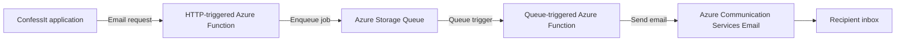
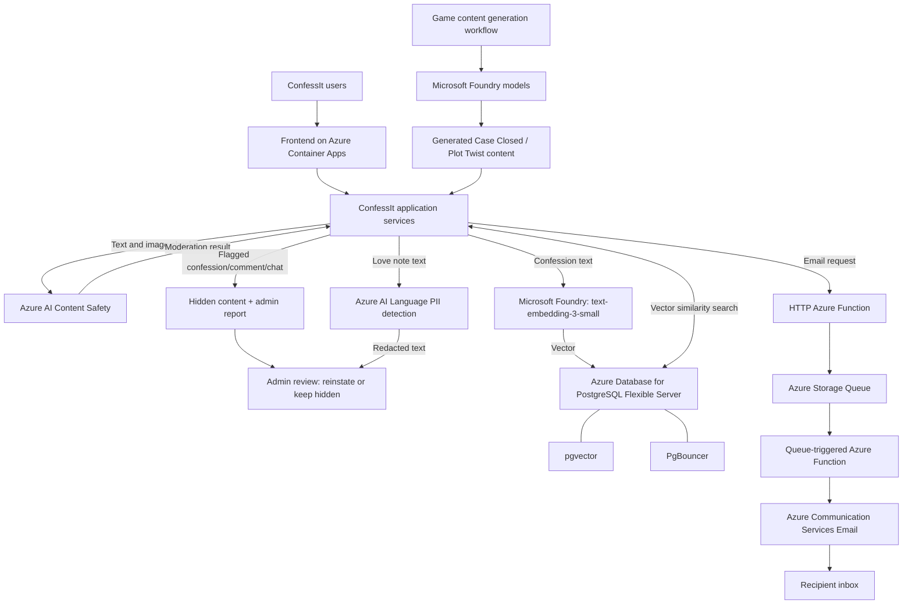

# ConfessIt — Azure Architecture and Services

This document records how ConfessIt uses Microsoft Azure for content moderation, privacy protection, semantic search, AI-powered games, email delivery, application hosting, and networking.

## At a glance

| Azure service / component | How ConfessIt uses it |
|---|---|
| **Azure AI Content Safety** | Moderates confession text, comments, chat messages, and uploaded profile images. Flagged confessions, comments, and chats are hidden and surfaced to administrators for review. |
| **Microsoft Foundry — `text-embedding-3-small`** | Generates vector embeddings for confessions to support semantic search. |
| **Azure Database for PostgreSQL Flexible Server** | Main relational database for application data and the storage/query layer for confession embeddings. The `pgvector` extension enables vector similarity search; PgBouncer provides connection pooling. |
| **Azure AI Language PII detection** | Detects and redacts personally identifiable information from love notes before the redacted version is shown to a moderator/admin. |
| **Microsoft Foundry models** | Generate the story packages and game content used by **Case Closed** and **Plot Twist**, including stories, options, outcomes, results, and weights. |
| **Azure Functions** | Accepts email-delivery requests and processes queued email jobs asynchronously. Both functions run in the same Function App. |
| **Azure Storage — Queue Storage** | Buffers email jobs between request acceptance and delivery, decoupling application requests from email sending. |
| **Azure Communication Services Email** | Sends transactional/application emails requested through the email pipeline. |
| **Azure Container Apps** | Hosts the containerized frontend and application services. |
| **Azure Container Apps networking / Virtual Network (VNet)** | Provides the network environment for the container apps. Private connectivity to other Azure resources depends on how those resources and network paths are configured. |
| **Container Apps HTTPS ingress and managed certificate** | Provides HTTPS for the hosted frontend. If a custom hostname is configured, the relevant feature is **Custom domains with a managed TLS certificate**. |

---

## 1. Content moderation — Azure AI Content Safety

**Purpose:** Check user-generated text and images for potentially harmful or inappropriate content before it is allowed to remain available in ConfessIt.

### Text moderation

Azure AI Content Safety is used for:

- Confessions
- Confession comments
- Chat messages

The application submits the relevant text to Content Safety and evaluates the moderation result against ConfessIt's configured moderation policy.

For confessions, comments, and chats, content that is flagged by the moderation flow is automatically hidden from the app and a report is created for the admin/moderation interface. The content is not automatically made visible again just because a report exists: an administrator reviews it and decides whether to **reinstate** it or **leave it hidden**.

This makes automated moderation the first pass and human review the final decision for reported items.

### Image moderation

Azure AI Content Safety also checks uploaded images, including profile pictures. The image is analyzed for potentially harmful content as part of the upload flow. The application then applies its configured policy to the result.

> **Important distinction:** The automatic hide-and-create-report behavior described above applies specifically to confessions, comments, and chats. The exact downstream action for a flagged profile image depends on the image-upload policy implemented in the application.

### Chat privacy and encryption

Chat text passes through Content Safety before the application's chat-encryption step. After moderation, the chat content is encrypted according to ConfessIt's chat-storage design.

This ordering is important: the moderation service must be able to inspect the submitted text, so the text cannot remain application-encrypted in a form that the moderation request cannot read at the point it is checked. Treat the moderation request and its transport, retention, and logging behavior as part of the chat privacy boundary.

**Official documentation:** [Azure AI Content Safety](https://learn.microsoft.com/en-us/azure/ai-services/content-safety/)

---

## 2. Semantic confession search — Microsoft Foundry embeddings and PostgreSQL

**Purpose:** Let users and administrators search confessions by meaning, rather than relying only on exact keyword matches.

### Embedding model

ConfessIt uses **`text-embedding-3-small`** through Microsoft Foundry to convert confession text into a numerical embedding vector. The application uses **1,536 dimensions** for these embeddings.

Only the confession content is embedded. Confession comments are deliberately excluded so that comments do not create an additional, potentially large volume of embeddings. Confessions are treated as immutable entities in this design, so edits to existing confessions and a separate historical backfill workflow are not part of the intended flow.

### Storage and search

Embeddings are stored alongside the application's PostgreSQL data in **Azure Database for PostgreSQL Flexible Server**. The database uses:

- **`pgvector`** to store vectors and run vector-similarity queries.
- **PgBouncer** for database connection pooling, reducing the overhead of maintaining many separate PostgreSQL connections.

The application can query the stored vectors to retrieve semantically similar confessions. Semantic search is available on both the **user-facing** and **admin-facing** sides of ConfessIt.

The responsibilities are separate:

1. **Microsoft Foundry embedding model:** turns confession text into a vector.
2. **PostgreSQL + `pgvector`:** stores the vectors and performs similarity search.
3. **ConfessIt application:** applies the search workflow and presents the results to the appropriate user or administrator.

**Official documentation:**

- [Microsoft Foundry documentation](https://learn.microsoft.com/en-us/azure/foundry/)
- [Use `pgvector` with Azure Database for PostgreSQL Flexible Server](https://learn.microsoft.com/en-us/azure/postgresql/extensions/how-to-use-pgvector)
- [PgBouncer in Azure Database for PostgreSQL Flexible Server](https://learn.microsoft.com/en-us/azure/postgresql/connectivity/concepts-pgbouncer)

---

## 3. Love-note anonymity — Azure AI Language PII detection

**Purpose:** Reduce the chance that a love note reveals a sender's identity through personally identifiable information (PII).

Every love note must be approved by a moderator/admin before it is sent. Before the love note is shown for review, ConfessIt uses **Azure AI Language PII detection** to identify and redact personal information in the text.

The moderation flow is:

1. A user submits a love note.
2. The application sends the text for PII detection and redaction.
3. The redacted version is presented to the moderator/admin for review.
4. The moderator/admin approves or rejects the love note.
5. Only an approved note proceeds through the application's sending workflow.

The purpose is to let the moderator review the message for approval without unnecessarily exposing personal details that could compromise anonymity. PII detection is a privacy aid, not a guarantee that every identifying detail or indirect clue will be detected; the approval process and application policy remain important.

**Official documentation:** [Detect and redact PII in text with Azure Language](https://learn.microsoft.com/en-us/azure/ai-services/language-service/personally-identifiable-information/how-to/redact-text-pii)

---

## 4. AI-generated game content — Microsoft Foundry models

**Purpose:** Generate structured content for ConfessIt's couple games **Case Closed** and **Plot Twist**.

Microsoft Foundry-hosted models are used to generate game content such as:

- Stories and narrative material
- Player options or choices
- Outcomes and results
- Weights used by the game's logic

The model is responsible for generating the authored game package; the ConfessIt application is responsible for validating, storing, publishing, and using that content in the game.

### Plot Twist generation and runtime

For Plot Twist, generation happens **before gameplay**. The generation workflow builds and validates a story package before it is published. Once a package is published, gameplay uses that package deterministically; the model is not called for each player choice. This keeps the live choice-submission path separate from the slower and less predictable AI-generation process.

Case Closed also uses Foundry models to generate its story/game components. The exact generation and runtime lifecycle may differ from Plot Twist where implemented by the game-specific pipeline.

**Official documentation:**

- [Microsoft Foundry](https://learn.microsoft.com/en-us/azure/foundry/)
- [Deployment options for Microsoft Foundry Models](https://learn.microsoft.com/en-us/azure/foundry/concepts/deployments-overview)

---

## 5. Asynchronous email delivery — Azure Functions, Queue Storage, and Azure Communication Services Email

**Purpose:** Keep email delivery out of the main application request path. ConfessIt's application code requests an email, while a separate background flow handles queueing and delivery.

### Components

- **Azure Functions:** hosts the request-acceptance function and the queue-triggered delivery function in the same Function App.
- **Azure Storage Queue:** stores email jobs until a worker processes them.
- **Azure Communication Services Email (ACS Email):** sends the actual email.

### Delivery flow

1. **Application request:** ConfessIt's application sends an email-delivery request to an HTTP-facing Azure Function.
2. **Accept and enqueue:** The function accepts the request and places an email job on Azure Storage Queue.
3. **Queue trigger:** A second function in the same Function App is triggered when a queue message is available.
4. **Send:** The queue-triggered function processes the job and calls ACS Email to send the message.
5. **Result handling:** The function handles the result of the send operation and any configured error/retry behavior.

### Why use a queue?

- The main application does not need to execute the full email-delivery operation before completing its own work.
- A temporary email-provider or network issue is less likely to block the originating application request.
- The queue separates accepting work from processing work and provides a place to manage queued jobs and retry behavior.

A successful email-send API operation should not automatically be treated as proof that a message reached the recipient's inbox. ACS provides email status and delivery-event capabilities for observing delivery outcomes.

**Official documentation:**

- [Azure Queue Storage triggers and bindings for Azure Functions](https://learn.microsoft.com/en-us/azure/azure-functions/functions-bindings-storage-queue)
- [Azure Communication Services Email overview](https://learn.microsoft.com/en-us/azure/communication-services/concepts/email/email-overview)
- [Send an email with Azure Communication Services](https://learn.microsoft.com/en-us/azure/communication-services/quickstarts/email/send-email)

---

## 6. Application hosting — Azure Container Apps

**Purpose:** Run the containerized frontend and application services without managing virtual machines directly.

ConfessIt's frontend is hosted in a container on Azure Container Apps. Container Apps also provides the hosting platform for the application's containerized services. Its ingress configuration controls how an app is exposed, and it supports HTTPS ingress and custom domains.

### HTTPS and certificates

The feature name you're likely thinking of is **Azure Container Apps custom domains with managed certificates**. For a custom domain, you bind the hostname to the Container App and select a **managed TLS/SSL certificate**. Azure provisions and manages the certificate, including renewal while the configuration continues to meet the platform's requirements.

If you are using only the generated `*.azurecontainerapps.io` application URL, that is distinct from binding your own custom domain. Check the Container App's **Custom domains** configuration to confirm which setup you have.

**Official documentation:**

- [Azure Container Apps overview](https://learn.microsoft.com/en-us/azure/container-apps/overview)
- [Custom domains and free managed certificates](https://learn.microsoft.com/en-us/azure/container-apps/custom-domains-managed-certificates)

---

## 7. Networking — Virtual Network and Container Apps environment

ConfessIt's containerized services run within an Azure Container Apps environment. A Container Apps environment has its own networking context and can use an automatically generated network or a virtual network that you provide.

When a custom VNet is configured, it can provide a network boundary and support additional controls such as network security groups, custom routing, and connectivity to resources behind private endpoints, depending on the environment's configuration.

**Important architecture distinction:** resources being in the same Azure subscription or resource group does **not** automatically mean they are all inside the same VNet, or that service-to-service traffic is private. Each service's network access must match the actual configuration. For example, private access to PostgreSQL requires compatible networking/private-access configuration on the database side as well as a valid route from the application environment. Do not assume that every Azure resource listed in this document is privately connected unless that has been configured and verified.

**Official documentation:**

- [Networking in an Azure Container Apps environment](https://learn.microsoft.com/en-us/azure/container-apps/networking)
- [Integrate a virtual network with an Azure Container Apps environment](https://learn.microsoft.com/en-us/azure/container-apps/vnet-custom)

---

## 8. End-to-end architecture summary

The diagram is conceptual: it shows the role of each service, not every network boundary, identity assignment, database table, deployment, or runtime connection.

## 9. Operational and security notes

- **Keep secrets out of source control.** Store service keys, connection strings, and model credentials in the application's configured secret mechanism and restrict access to the identities that need them.
- **Treat moderation as a workflow, not only an API call.** The application's thresholds, hidden-content state, report creation, administrator decisions, and audit history determine the final behavior.
- **Treat PII redaction as risk reduction, not a guarantee of anonymity.** It can miss indirect identifiers, context, or unusual personal details.
- **Monitor email delivery separately from queue acceptance.** A queued job means it was accepted for processing; a successful send operation does not necessarily mean it was delivered to the inbox.
- **Verify network boundaries from the actual resource configuration.** A VNet associated with Container Apps does not automatically make every related Azure service private.

---

## Official Azure references

- [Azure AI Content Safety](https://learn.microsoft.com/en-us/azure/ai-services/content-safety/)
- [Azure Language PII detection and redaction](https://learn.microsoft.com/en-us/azure/ai-services/language-service/personally-identifiable-information/how-to/redact-text-pii)
- [Microsoft Foundry documentation](https://learn.microsoft.com/en-us/azure/foundry/)
- [Azure Database for PostgreSQL `pgvector`](https://learn.microsoft.com/en-us/azure/postgresql/extensions/how-to-use-pgvector)
- [Azure Database for PostgreSQL PgBouncer](https://learn.microsoft.com/en-us/azure/postgresql/connectivity/concepts-pgbouncer)
- [Azure Functions Queue Storage bindings](https://learn.microsoft.com/en-us/azure/azure-functions/functions-bindings-storage-queue)
- [Azure Communication Services Email](https://learn.microsoft.com/en-us/azure/communication-services/concepts/email/email-overview)
- [Azure Container Apps](https://learn.microsoft.com/en-us/azure/container-apps/overview)
- [Container Apps managed certificates](https://learn.microsoft.com/en-us/azure/container-apps/custom-domains-managed-certificates)
- [Container Apps networking](https://learn.microsoft.com/en-us/azure/container-apps/networking)
